# Awesome GPT-6.2 Astra

English · [简体中文](README.zh-CN.md)

[](https://awesome.re) [](#contents) [](docs/prompts.md) [](https://github.com/sandbase-lab/awesome-gpt-6-2-astra/actions/workflows/sync.yml) [](https://www.sandbase.ai/model/openai/gpt-6.2-astra?utm_source=github&utm_medium=readme&utm_campaign=awesome-gpt-6-2-astra)

[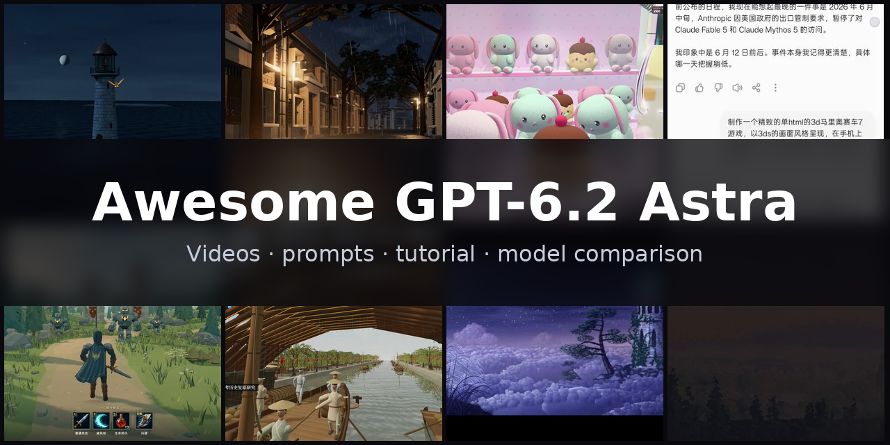](https://www.sandbase.ai/lab/ai-videos/gpt-6-2-astra?utm_source=github&utm_medium=readme&utm_campaign=awesome-gpt-6-2-astra&utm_content=banner)

A curated list of **GPT-6.2 Astra examples**: videos, prompts and demos made with GPT-6.2 Astra, OpenAI's model announced on November 1, 2026. Three.js and WebGPU 3D scenes, motion graphics, product UI, games and explainers, each one credited to its creator and linked to the original post. The model writes code, and each video is a page recorded as it plays.

**31 videos** from **25 creators** · **2** with the creator's prompt · synced daily from [SandBase Lab](https://www.sandbase.ai/lab/ai-videos/gpt-6-2-astra?utm_source=github&utm_medium=readme&utm_campaign=awesome-gpt-6-2-astra&utm_content=stats)

## Start here

| I want to… | Go to |
|---|---|
| Watch the videos | [Browse by category](#contents) below, or [play them full-size on SandBase Lab](https://www.sandbase.ai/lab/ai-videos/gpt-6-2-astra?utm_source=github&utm_medium=readme&utm_campaign=awesome-gpt-6-2-astra&utm_content=quickstart) |
| Copy a prompt | [Prompt index](docs/prompts.md): every video that comes with its prompt |
| Write your own prompt | [Prompt guide](docs/prompt-guide.md): 2 patterns and a fill-in template |
| Make a video | [Tutorial](docs/tutorial.md): prompt → HTML → MP4, with the API, the CLI and a recording script |
| Pick a model | [GPT-6.2 Astra vs. Fable 5.5 and Claude Opus 5.5](docs/model-comparison.md) |
| Try it now | [Run GPT-6.2 Astra in the Lab arena](https://www.sandbase.ai/arena/text?models=openai%2Fgpt-6.2-astra&utm_source=github&utm_medium=readme&utm_campaign=awesome-gpt-6-2-astra&utm_content=quickstart), next to other models |

<a id="contents"></a>

## Contents

- [Featured](#featured) (8)
- [3D scenes](#3d-scene) (6)
- [Motion graphics](#motion-graphics) (10)
- [Games](#game) (3)
- [Product UI](#ui-demo) (1)
- [Explainers](#explainer) (2)
- [Tests & comparisons](#comparison) (9)
- [Recreate a video with GPT-6.2 Astra](#recreate)
- [FAQ](#faq)
- [Suggest a video](#contribute)

Click a preview to play the video. Click a title for the post, the prompt and **Recreate** on SandBase Lab. **@handle** links to the creator's post on X.

<a id="featured"></a>

## Featured

<table>
<tr><td width="33%" valign="top"><a href="https://www.sandbase.ai/lab/media/x/gpt-6-2-astra/2119811022873575426/video.mp4">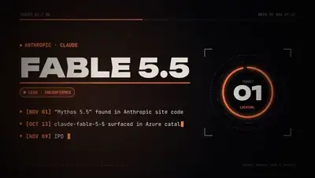</a><br><a href="https://www.sandbase.ai/lab/ai-videos/gpt-6-2-astra/2119811022873575426?utm_source=github&utm_medium=readme&utm_campaign=awesome-gpt-6-2-astra&utm_content=card"><b>Discussion of upcoming top AI models</b></a><br><sub><a href="https://x.com/kepochnik/status/2119811022873575426">@kepochnik</a> · 0:36</sub></td><td width="33%" valign="top"><a href="https://www.sandbase.ai/lab/media/x/gpt-6-2-astra/2118016475696894413/video.mp4">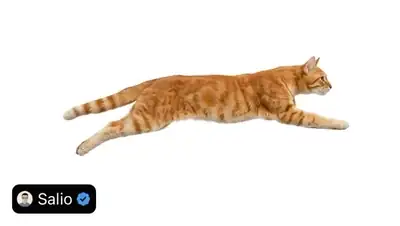</a><br><a href="https://www.sandbase.ai/lab/ai-videos/gpt-6-2-astra/2118016475696894413?utm_source=github&utm_medium=readme&utm_campaign=awesome-gpt-6-2-astra&utm_content=card"><b>Realistic cat SVG made by GPT-6.2 Astra</b></a><br><sub><a href="https://x.com/R2Cdev_/status/2118016475696894413">@R2Cdev_</a> · 0:06</sub></td><td width="33%" valign="top"><a href="https://www.sandbase.ai/lab/media/x/gpt-6-2-astra/2119407085251170617/video.mp4">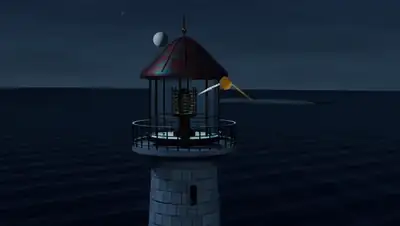</a><br><a href="https://www.sandbase.ai/lab/ai-videos/gpt-6-2-astra/2119407085251170617?utm_source=github&utm_medium=readme&utm_campaign=awesome-gpt-6-2-astra&utm_content=card"><b>A 3D lighthouse created with Vork engine</b></a><br><sub><a href="https://x.com/rubenssoto_ai/status/2119407085251170617">@rubenssoto_ai</a> · 0:30</sub></td></tr>
<tr><td width="33%" valign="top"><a href="https://www.sandbase.ai/lab/media/x/gpt-6-2-astra/2119289814222614575/video.mp4">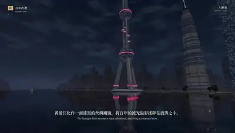</a><br><a href="https://www.sandbase.ai/lab/ai-videos/gpt-6-2-astra/2119289814222614575?utm_source=github&utm_medium=readme&utm_campaign=awesome-gpt-6-2-astra&utm_content=card"><b>Shanghai night view rendered in Three.js</b></a><br><sub><a href="https://x.com/YFeng2022/status/2119289814222614575">@YFeng2022</a> · 1:48</sub></td><td width="33%" valign="top"><a href="https://www.sandbase.ai/lab/media/x/gpt-6-2-astra/2117987734380011727/video.mp4">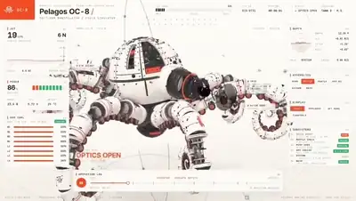</a><br><a href="https://www.sandbase.ai/lab/ai-videos/gpt-6-2-astra/2117987734380011727?utm_source=github&utm_medium=readme&utm_campaign=awesome-gpt-6-2-astra&utm_content=card"><b>A video generated by GPT-6.2 Astra</b></a><br><sub><a href="https://x.com/JamesMalsawm/status/2117987734380011727">@JamesMalsawm</a> · 0:23</sub></td><td width="33%" valign="top"><a href="https://www.sandbase.ai/lab/media/x/gpt-6-2-astra/2118310499213312478/video.mp4">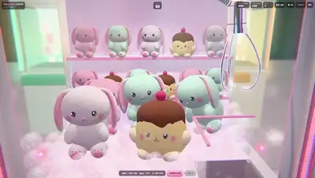</a><br><a href="https://www.sandbase.ai/lab/ai-videos/gpt-6-2-astra/2118310499213312478?utm_source=github&utm_medium=readme&utm_campaign=awesome-gpt-6-2-astra&utm_content=card"><b>3D claw crane game made with Three.js</b></a><br><sub><a href="https://x.com/RenaRoze_doll/status/2118310499213312478">@RenaRoze_doll</a> · 0:32</sub></td></tr>
<tr><td width="33%" valign="top"><a href="https://www.sandbase.ai/lab/media/x/gpt-6-2-astra/2117651236589797572/video.mp4">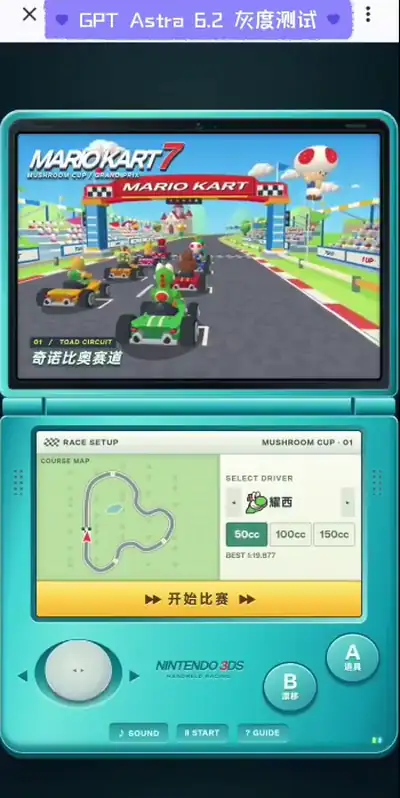</a><br><a href="https://www.sandbase.ai/lab/ai-videos/gpt-6-2-astra/2117651236589797572?utm_source=github&utm_medium=readme&utm_campaign=awesome-gpt-6-2-astra&utm_content=card"><b>Mobile clone of Mario Kart game</b></a><br><sub><a href="https://x.com/Smlay_ero/status/2117651236589797572">@Smlay_ero</a> · 0:56</sub></td><td width="33%" valign="top"><a href="https://www.sandbase.ai/lab/media/x/gpt-6-2-astra/2117730946518745210/video.mp4">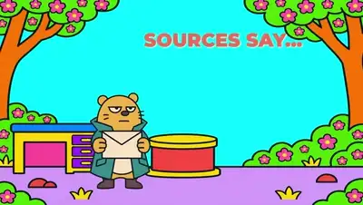</a><br><a href="https://www.sandbase.ai/lab/ai-videos/gpt-6-2-astra/2117730946518745210?utm_source=github&utm_medium=readme&utm_campaign=awesome-gpt-6-2-astra&utm_content=card"><b>A nature documentary parody of social feeds</b></a><br><sub><a href="https://x.com/RezAIT00/status/2117730946518745210">@RezAIT00</a> · 2:19</sub></td></tr>
</table>

<a id="3d-scene"></a>

## 3D scenes

<table>
<tr><td width="33%" valign="top"><a href="https://www.sandbase.ai/lab/media/x/gpt-6-2-astra/2117224524236181525/video.mp4">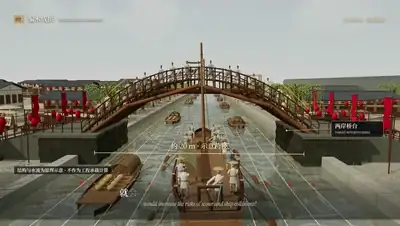</a><br><a href="https://www.sandbase.ai/lab/ai-videos/gpt-6-2-astra/2117224524236181525?utm_source=github&utm_medium=readme&utm_campaign=awesome-gpt-6-2-astra&utm_content=card"><b>Along the River During the Qingming Festival in Three.js</b></a><br><sub><a href="https://x.com/YFeng2022/status/2117224524236181525">@YFeng2022</a> · 3:37</sub></td><td width="33%" valign="top"><a href="https://www.sandbase.ai/lab/media/x/gpt-6-2-astra/2117924044439712156/video.mp4">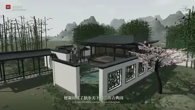</a><br><a href="https://www.sandbase.ai/lab/ai-videos/gpt-6-2-astra/2117924044439712156?utm_source=github&utm_medium=readme&utm_campaign=awesome-gpt-6-2-astra&utm_content=card"><b>Chinese aesthetic 3D scene rendered in Three.js</b></a><br><sub><a href="https://x.com/YFeng2022/status/2117924044439712156">@YFeng2022</a> · 3:28</sub></td><td width="33%" valign="top"><a href="https://www.sandbase.ai/lab/media/x/gpt-6-2-astra/2119289814222614575/video.mp4"></a><br><a href="https://www.sandbase.ai/lab/ai-videos/gpt-6-2-astra/2119289814222614575?utm_source=github&utm_medium=readme&utm_campaign=awesome-gpt-6-2-astra&utm_content=card"><b>Shanghai night view rendered in Three.js</b></a><br><sub><a href="https://x.com/YFeng2022/status/2119289814222614575">@YFeng2022</a> · 1:48</sub></td></tr>
<tr><td width="33%" valign="top"><a href="https://www.sandbase.ai/lab/media/x/gpt-6-2-astra/2119407085251170617/video.mp4"></a><br><a href="https://www.sandbase.ai/lab/ai-videos/gpt-6-2-astra/2119407085251170617?utm_source=github&utm_medium=readme&utm_campaign=awesome-gpt-6-2-astra&utm_content=card"><b>A 3D lighthouse created with Vork engine</b></a><br><sub><a href="https://x.com/rubenssoto_ai/status/2119407085251170617">@rubenssoto_ai</a> · 0:30</sub></td><td width="33%" valign="top"><a href="https://www.sandbase.ai/lab/media/x/gpt-6-2-astra/2119424014640726035/video.mp4">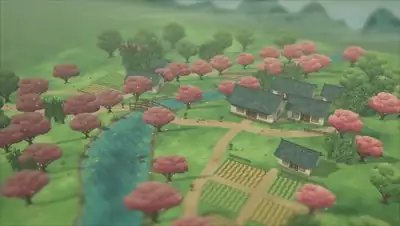</a><br><a href="https://www.sandbase.ai/lab/ai-videos/gpt-6-2-astra/2119424014640726035?utm_source=github&utm_medium=readme&utm_campaign=awesome-gpt-6-2-astra&utm_content=card"><b>A village in a single HTML Three.js file</b></a><br><sub><a href="https://x.com/dedene/status/2119424014640726035">@dedene</a> · 0:05</sub></td><td width="33%" valign="top"><a href="https://www.sandbase.ai/lab/media/x/gpt-6-2-astra/2119521331637285138/video.mp4">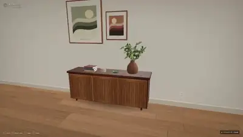</a><br><a href="https://www.sandbase.ai/lab/ai-videos/gpt-6-2-astra/2119521331637285138?utm_source=github&utm_medium=readme&utm_campaign=awesome-gpt-6-2-astra&utm_content=card"><b>Kitchen scene generation test</b></a><br><sub><a href="https://x.com/mirochill/status/2119521331637285138">@mirochill</a> · 0:44</sub></td></tr>
</table>

<a id="motion-graphics"></a>

## Motion graphics

<table>
<tr><td width="33%" valign="top"><a href="https://www.sandbase.ai/lab/media/x/gpt-6-2-astra/2117234394943586473/video.mp4">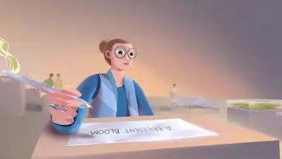</a><br><a href="https://www.sandbase.ai/lab/ai-videos/gpt-6-2-astra/2117234394943586473?utm_source=github&utm_medium=readme&utm_campaign=awesome-gpt-6-2-astra&utm_content=card"><b>Video demonstration attributed to GPT-6.2 Astra</b></a><br><sub><a href="https://x.com/gadi_neelesh/status/2117234394943586473">@gadi_neelesh</a> · 1:17</sub></td><td width="33%" valign="top"><a href="https://www.sandbase.ai/lab/media/x/gpt-6-2-astra/2117242834017497336/video.mp4"></a><br><a href="https://www.sandbase.ai/lab/ai-videos/gpt-6-2-astra/2117242834017497336?utm_source=github&utm_medium=readme&utm_campaign=awesome-gpt-6-2-astra&utm_content=card"><b>Code-generated animation with sound effects</b></a><br><sub><a href="https://x.com/badboyfoxy/status/2117242834017497336">@badboyfoxy</a> · 0:58</sub></td><td width="33%" valign="top"><a href="https://www.sandbase.ai/lab/media/x/gpt-6-2-astra/2117263042329370877/video.mp4">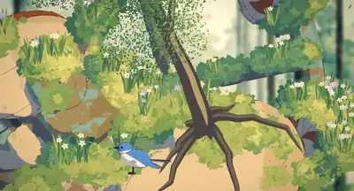</a><br><a href="https://www.sandbase.ai/lab/ai-videos/gpt-6-2-astra/2117263042329370877?utm_source=github&utm_medium=readme&utm_campaign=awesome-gpt-6-2-astra&utm_content=card"><b>Animation generated purely from code</b></a><br><sub><a href="https://x.com/Smlay_ero/status/2117263042329370877">@Smlay_ero</a> · 1:21</sub></td></tr>
<tr><td width="33%" valign="top"><a href="https://www.sandbase.ai/lab/media/x/gpt-6-2-astra/2117289480608460897/video.mp4">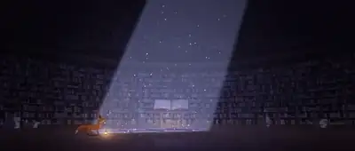</a><br><a href="https://www.sandbase.ai/lab/ai-videos/gpt-6-2-astra/2117289480608460897?utm_source=github&utm_medium=readme&utm_campaign=awesome-gpt-6-2-astra&utm_content=card"><b>Animated short film remade entirely through code</b></a><br><sub><a href="https://x.com/marcthecreatorr/status/2117289480608460897">@marcthecreatorr</a> · 0:58</sub></td><td width="33%" valign="top"><a href="https://www.sandbase.ai/lab/media/x/gpt-6-2-astra/2117591011388010548/video.mp4">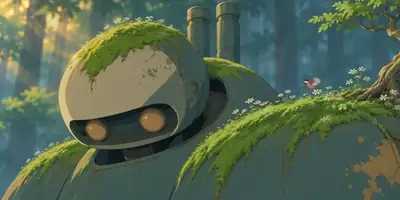</a><br><a href="https://www.sandbase.ai/lab/ai-videos/gpt-6-2-astra/2117591011388010548?utm_source=github&utm_medium=readme&utm_campaign=awesome-gpt-6-2-astra&utm_content=card"><b>Self-generated video by GPT-6.2 Astra</b></a><br><sub><a href="https://x.com/TokenGremlin/status/2117591011388010548">@TokenGremlin</a> · 0:10</sub></td><td width="33%" valign="top"><a href="https://www.sandbase.ai/lab/media/x/gpt-6-2-astra/2117987734380011727/video.mp4"></a><br><a href="https://www.sandbase.ai/lab/ai-videos/gpt-6-2-astra/2117987734380011727?utm_source=github&utm_medium=readme&utm_campaign=awesome-gpt-6-2-astra&utm_content=card"><b>A video generated by GPT-6.2 Astra</b></a><br><sub><a href="https://x.com/JamesMalsawm/status/2117987734380011727">@JamesMalsawm</a> · 0:23</sub></td></tr>
</table>

<details>
<summary><b>Show all 10</b></summary>

<table>
<tr><td width="33%" valign="top"><a href="https://www.sandbase.ai/lab/media/x/gpt-6-2-astra/2118016475696894413/video.mp4"></a><br><a href="https://www.sandbase.ai/lab/ai-videos/gpt-6-2-astra/2118016475696894413?utm_source=github&utm_medium=readme&utm_campaign=awesome-gpt-6-2-astra&utm_content=card"><b>Realistic cat SVG made by GPT-6.2 Astra</b></a><br><sub><a href="https://x.com/R2Cdev_/status/2118016475696894413">@R2Cdev_</a> · 0:06</sub></td><td width="33%" valign="top"><a href="https://www.sandbase.ai/lab/media/x/gpt-6-2-astra/2118366708096549202/video.mp4">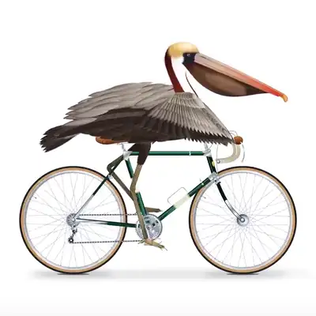</a><br><a href="https://www.sandbase.ai/lab/ai-videos/gpt-6-2-astra/2118366708096549202?utm_source=github&utm_medium=readme&utm_campaign=awesome-gpt-6-2-astra&utm_content=card"><b>Pure SVG animation of a pelican pedaling</b></a><br><sub><a href="https://x.com/Adidotdev/status/2118366708096549202">@Adidotdev</a> · 0:10</sub></td><td width="33%" valign="top"><a href="https://www.sandbase.ai/lab/media/x/gpt-6-2-astra/2119399538792521828/video.mp4">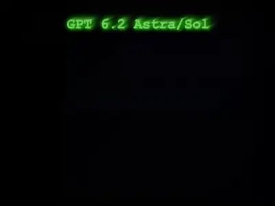</a><br><a href="https://www.sandbase.ai/lab/ai-videos/gpt-6-2-astra/2119399538792521828?utm_source=github&utm_medium=readme&utm_campaign=awesome-gpt-6-2-astra&utm_content=card"><b>One-shot animated graphic generated by code</b></a><br><sub><a href="https://x.com/ritu_twts/status/2119399538792521828">@ritu_twts</a> · 0:13</sub></td></tr>
<tr><td width="33%" valign="top"><a href="https://www.sandbase.ai/lab/media/x/gpt-6-2-astra/2120625322823684444/video.mp4">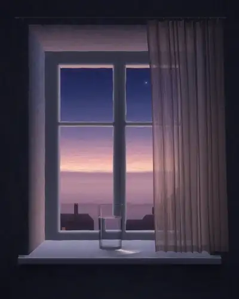</a><br><a href="https://www.sandbase.ai/lab/ai-videos/gpt-6-2-astra/2120625322823684444?utm_source=github&utm_medium=readme&utm_campaign=awesome-gpt-6-2-astra&utm_content=card"><b>Pure JavaScript animation with AI model wishlist</b></a><br><sub><a href="https://x.com/pradeepXkapoor/status/2120625322823684444">@pradeepXkapoor</a> · 0:30</sub></td></tr>
</table>

</details>

<a id="game"></a>

## Games

<table>
<tr><td width="33%" valign="top"><a href="https://www.sandbase.ai/lab/media/x/gpt-6-2-astra/2116895719248536032/video.mp4">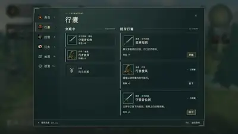</a><br><a href="https://www.sandbase.ai/lab/ai-videos/gpt-6-2-astra/2116895719248536032?utm_source=github&utm_medium=readme&utm_campaign=awesome-gpt-6-2-astra&utm_content=card"><b>A 3D RPG game generated from one prompt</b></a><br><sub><a href="https://x.com/karanC_12/status/2116895719248536032">@karanC_12</a> · 0:57</sub></td><td width="33%" valign="top"><a href="https://www.sandbase.ai/lab/media/x/gpt-6-2-astra/2117651236589797572/video.mp4"></a><br><a href="https://www.sandbase.ai/lab/ai-videos/gpt-6-2-astra/2117651236589797572?utm_source=github&utm_medium=readme&utm_campaign=awesome-gpt-6-2-astra&utm_content=card"><b>Mobile clone of Mario Kart game</b></a><br><sub><a href="https://x.com/Smlay_ero/status/2117651236589797572">@Smlay_ero</a> · 0:56</sub></td><td width="33%" valign="top"><a href="https://www.sandbase.ai/lab/media/x/gpt-6-2-astra/2118310499213312478/video.mp4"></a><br><a href="https://www.sandbase.ai/lab/ai-videos/gpt-6-2-astra/2118310499213312478?utm_source=github&utm_medium=readme&utm_campaign=awesome-gpt-6-2-astra&utm_content=card"><b>3D claw crane game made with Three.js</b></a><br><sub><a href="https://x.com/RenaRoze_doll/status/2118310499213312478">@RenaRoze_doll</a> · 0:32</sub></td></tr>
</table>

<a id="ui-demo"></a>

## Product UI

<table>
<tr><td width="33%" valign="top"><a href="https://www.sandbase.ai/lab/media/x/gpt-6-2-astra/2118163378891805134/video.mp4">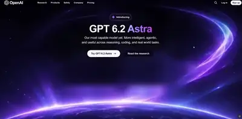</a><br><a href="https://www.sandbase.ai/lab/ai-videos/gpt-6-2-astra/2118163378891805134?utm_source=github&utm_medium=readme&utm_campaign=awesome-gpt-6-2-astra&utm_content=card"><b>Animated launch page generated for GPT-6.2 Astra</b></a><br><sub><a href="https://x.com/Layton_Gott/status/2118163378891805134">@Layton_Gott</a> · 0:07</sub></td></tr>
</table>

<a id="explainer"></a>

## Explainers

<table>
<tr><td width="33%" valign="top"><a href="https://www.sandbase.ai/lab/media/x/gpt-6-2-astra/2117730946518745210/video.mp4"></a><br><a href="https://www.sandbase.ai/lab/ai-videos/gpt-6-2-astra/2117730946518745210?utm_source=github&utm_medium=readme&utm_campaign=awesome-gpt-6-2-astra&utm_content=card"><b>A nature documentary parody of social feeds</b></a><br><sub><a href="https://x.com/RezAIT00/status/2117730946518745210">@RezAIT00</a> · 2:19</sub></td><td width="33%" valign="top"><a href="https://www.sandbase.ai/lab/media/x/gpt-6-2-astra/2119811022873575426/video.mp4"></a><br><a href="https://www.sandbase.ai/lab/ai-videos/gpt-6-2-astra/2119811022873575426?utm_source=github&utm_medium=readme&utm_campaign=awesome-gpt-6-2-astra&utm_content=card"><b>Discussion of upcoming top AI models</b></a><br><sub><a href="https://x.com/kepochnik/status/2119811022873575426">@kepochnik</a> · 0:36</sub></td></tr>
</table>

<a id="comparison"></a>

## Tests & comparisons

<table>
<tr><td width="33%" valign="top"><a href="https://www.sandbase.ai/lab/media/x/gpt-6-2-astra/2116883000361427433/video.mp4">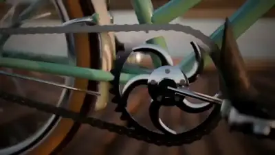</a><br><a href="https://www.sandbase.ai/lab/ai-videos/gpt-6-2-astra/2116883000361427433?utm_source=github&utm_medium=readme&utm_campaign=awesome-gpt-6-2-astra&utm_content=card"><b>Pelican riding a bicycle SVG animation</b></a><br><sub><a href="https://x.com/xiax0603/status/2116883000361427433">@xiax0603</a> · 0:39</sub></td><td width="33%" valign="top"><a href="https://www.sandbase.ai/lab/media/x/gpt-6-2-astra/2116902431451918603/video.mp4">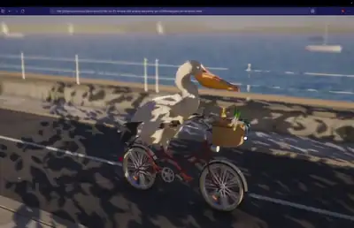</a><br><a href="https://www.sandbase.ai/lab/ai-videos/gpt-6-2-astra/2116902431451918603?utm_source=github&utm_medium=readme&utm_campaign=awesome-gpt-6-2-astra&utm_content=card"><b>3D pelican render in Fable 5.5</b></a><br><sub><a href="https://x.com/Smlay_ero/status/2116902431451918603">@Smlay_ero</a> · 0:16</sub></td><td width="33%" valign="top"><a href="https://www.sandbase.ai/lab/media/x/gpt-6-2-astra/2117210973576765462/video.mp4">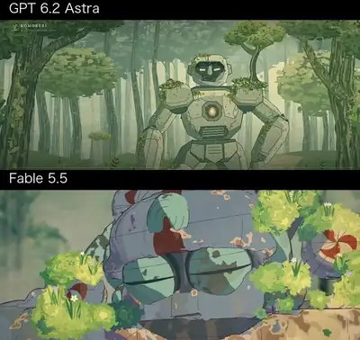</a><br><a href="https://www.sandbase.ai/lab/ai-videos/gpt-6-2-astra/2117210973576765462?utm_source=github&utm_medium=readme&utm_campaign=awesome-gpt-6-2-astra&utm_content=card"><b>Front-end code animation comparison between two models</b></a><br><sub><a href="https://x.com/Smlay_ero/status/2117210973576765462">@Smlay_ero</a> · 1:02</sub></td></tr>
<tr><td width="33%" valign="top"><a href="https://www.sandbase.ai/lab/media/x/gpt-6-2-astra/2117222592536789149/video.mp4">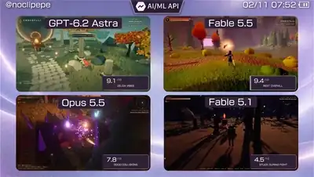</a><br><a href="https://www.sandbase.ai/lab/ai-videos/gpt-6-2-astra/2117222592536789149?utm_source=github&utm_medium=readme&utm_campaign=awesome-gpt-6-2-astra&utm_content=card"><b>Four-model comparison creating a 3D open-world RPG</b></a><br><sub><a href="https://x.com/noclipepe/status/2117222592536789149">@noclipepe</a> · 0:48</sub></td><td width="33%" valign="top"><a href="https://www.sandbase.ai/lab/media/x/gpt-6-2-astra/2117955030506709468/video.mp4">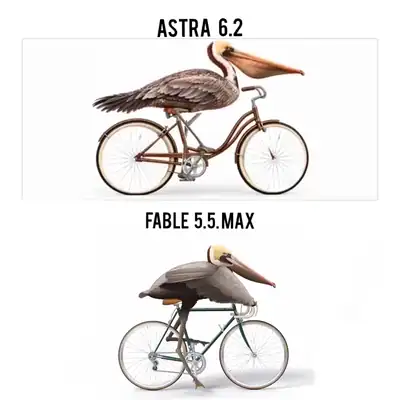</a><br><a href="https://www.sandbase.ai/lab/ai-videos/gpt-6-2-astra/2117955030506709468?utm_source=github&utm_medium=readme&utm_campaign=awesome-gpt-6-2-astra&utm_content=card"><b>Pelican riding a bicycle SVG comparison</b></a><br><sub><a href="https://x.com/Its_lakshya_ai/status/2117955030506709468">@Its_lakshya_ai</a> · 0:25 · <a href="https://www.sandbase.ai/lab/ai-videos/gpt-6-2-astra/2117955030506709468?utm_source=github&utm_medium=readme&utm_campaign=awesome-gpt-6-2-astra&utm_content=card">prompt</a></sub></td><td width="33%" valign="top"><a href="https://www.sandbase.ai/lab/media/x/gpt-6-2-astra/2117973639333298513/video.mp4">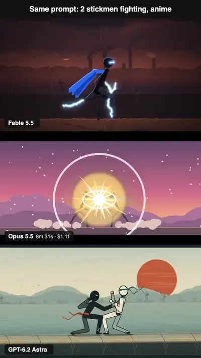</a><br><a href="https://www.sandbase.ai/lab/ai-videos/gpt-6-2-astra/2117973639333298513?utm_source=github&utm_medium=readme&utm_campaign=awesome-gpt-6-2-astra&utm_content=card"><b>Anime style stickman fight animation comparison</b></a><br><sub><a href="https://x.com/leohuanfang/status/2117973639333298513">@leohuanfang</a> · 0:13 · <a href="https://www.sandbase.ai/lab/ai-videos/gpt-6-2-astra/2117973639333298513?utm_source=github&utm_medium=readme&utm_campaign=awesome-gpt-6-2-astra&utm_content=card">prompt</a></sub></td></tr>
</table>

<details>
<summary><b>Show all 9</b></summary>

<table>
<tr><td width="33%" valign="top"><a href="https://www.sandbase.ai/lab/media/x/gpt-6-2-astra/2117987228764840440/video.mp4">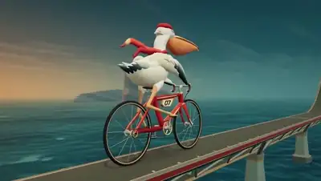</a><br><a href="https://www.sandbase.ai/lab/ai-videos/gpt-6-2-astra/2117987228764840440?utm_source=github&utm_medium=readme&utm_campaign=awesome-gpt-6-2-astra&utm_content=card"><b>3D pelican on a bike with solar eclipse</b></a><br><sub><a href="https://x.com/EnvolDev/status/2117987228764840440">@EnvolDev</a> · 0:18</sub></td><td width="33%" valign="top"><a href="https://www.sandbase.ai/lab/media/x/gpt-6-2-astra/2118581595267539404/video.mp4">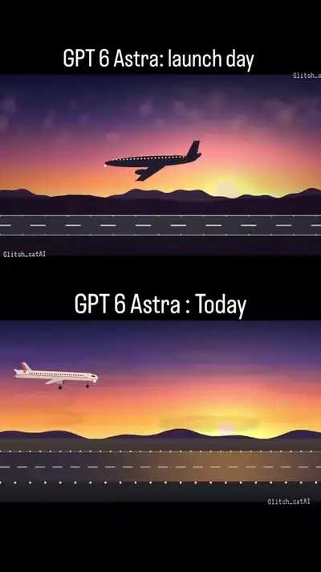</a><br><a href="https://www.sandbase.ai/lab/ai-videos/gpt-6-2-astra/2118581595267539404?utm_source=github&utm_medium=readme&utm_campaign=awesome-gpt-6-2-astra&utm_content=card"><b>GPT-6 Astra launch day versus current version</b></a><br><sub><a href="https://x.com/glitch_catAI/status/2118581595267539404">@glitch_catAI</a> · 0:09</sub></td><td width="33%" valign="top"><a href="https://www.sandbase.ai/lab/media/x/gpt-6-2-astra/2119527377109672111/video.mp4">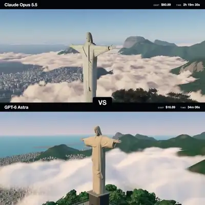</a><br><a href="https://www.sandbase.ai/lab/ai-videos/gpt-6-2-astra/2119527377109672111?utm_source=github&utm_medium=readme&utm_campaign=awesome-gpt-6-2-astra&utm_content=card"><b>Claude Opus 5.5 versus GPT-6 Astra 3D comparison</b></a><br><sub><a href="https://x.com/EnvolDev/status/2119527377109672111">@EnvolDev</a> · 0:25</sub></td></tr>
</table>

</details>

**[See all 31 on SandBase Lab →](https://www.sandbase.ai/lab/ai-videos/gpt-6-2-astra?utm_source=github&utm_medium=readme&utm_campaign=awesome-gpt-6-2-astra&utm_content=section)**

<a id="recreate"></a>

## Recreate a video with GPT-6.2 Astra

Every video page on [SandBase Lab](https://www.sandbase.ai/lab/ai-videos/gpt-6-2-astra?utm_source=github&utm_medium=readme&utm_campaign=awesome-gpt-6-2-astra&utm_content=recreate) has a **Recreate** button: it sends the post to GPT-6.2 Astra in the Lab text arena and returns the code, ready to play in the browser.

With the API, GPT-6.2 Astra is `openai/gpt-6.2-astra` on SandBase (OpenAI-compatible). Put a prompt in `prompt.txt`, create a key in the [console](https://www.sandbase.ai/console/keys?utm_source=github&utm_medium=readme&utm_campaign=awesome-gpt-6-2-astra), and run:

```bash
jq -n --rawfile prompt prompt.txt \
  '{model: "openai/gpt-6.2-astra", max_tokens: 128000, messages: [{role: "user", content: $prompt}]}' |
curl -sS --max-time 900 https://api.sandbase.ai/v1/chat/completions \
  -H "Authorization: Bearer $SANDBASE_API_KEY" \
  -H "Content-Type: application/json" \
  -d @- | jq -r '.choices[0].message.content' | sed '/^```/d' > astra.html
```

Open `astra.html` in a browser, or run it in a [SandBase Sandbox](https://www.sandbase.ai/landing/sandbox?utm_source=github&utm_medium=readme&utm_campaign=awesome-gpt-6-2-astra) to keep generated code isolated. The call above sets `max_tokens` to 128,000 so a long page is not cut off. Full walkthrough: [tutorial](docs/tutorial.md). Pricing: [model page](https://www.sandbase.ai/model/openai/gpt-6.2-astra?utm_source=github&utm_medium=readme&utm_campaign=awesome-gpt-6-2-astra).

<a id="faq"></a>

## FAQ

### What is GPT-6.2 Astra?

GPT-6.2 Astra is an OpenAI model, announced on November 1, 2026. Creators in this collection ran it next to Claude Opus 5.5 and Fable 5.5. On SandBase its id is `openai/gpt-6.2-astra`.

### How are these GPT-6.2 Astra videos made?

The model doesn't render video. It writes a web page, and the creator records the page playing. See the [tutorial](docs/tutorial.md).

### Where do I find the prompt for a video?

Videos tagged **prompt** come with the creator's prompt on their Lab page. The [prompt index](docs/prompts.md) lists all of them.

### How do I write a good GPT-6.2 Astra prompt?

Name one self-contained HTML file and the renderer you want, describe the scene and the state a recording should catch, rule out external assets, and ask the model to test its own page. Details and a template: [prompt guide](docs/prompt-guide.md).

### How do I use the GPT-6.2 Astra API?

On SandBase the model id is `openai/gpt-6.2-astra` on the OpenAI-compatible `/v1/chat/completions` endpoint. See [Recreate](#recreate) and the [model page](https://www.sandbase.ai/model/openai/gpt-6.2-astra?utm_source=github&utm_medium=readme&utm_campaign=awesome-gpt-6-2-astra).

### Is GPT-6.2 Astra better than Fable 5.5 or Claude Opus 5.5?

So far the evidence is creator runs, and they point different ways. On one stickman-fight prompt, GPT-6.2 Astra cost $1.65, against $15.71 for Fable 5.5 in Claude Code and $1.11 for Opus 5.5 with no tools. On a pelican SVG shown side by side with Fable 5.5 Max, the creator called both outputs "seriously impressive" and asked viewers to pick. This list has no measured GPT-6.2 Astra result yet: its Evals and Pelican Test rows were not in the sources it was built from. Details: [model comparison](docs/model-comparison.md).

### How much does one video cost?

A creator reported $1.65 for one GPT-6.2 Astra run on the stickman prompt, next to $15.71 for Fable 5.5 and $1.11 for Opus 5.5 on the same prompt. These are single runs with each creator's own setup. For list price, see the [model page](https://www.sandbase.ai/model/openai/gpt-6.2-astra?utm_source=github&utm_medium=readme&utm_campaign=awesome-gpt-6-2-astra).

### Can I reuse these videos?

No, not by default. They belong to their creators. See [MEDIA-RIGHTS](MEDIA-RIGHTS.md).

<a id="contribute"></a>

## Suggest a video

Know a GPT-6.2 Astra creation that should be here? [Open a submission](https://github.com/sandbase-lab/awesome-gpt-6-2-astra/issues/new?template=submit-video.yml) with the original X post. Accepted posts are added on SandBase Lab and show up here on the next daily sync. If this list helped you, a ⭐ helps others find it.

## Credits & rights

Every video, prompt and post belongs to its creator. Cards credit the author and link to the original post. The MIT license covers this repository's scripts only. To correct a credit or remove a video, see [MEDIA-RIGHTS](MEDIA-RIGHTS.md).

Not affiliated with or endorsed by OpenAI.

---

Maintained by [SandBase Lab](https://www.sandbase.ai/lab/?utm_source=github&utm_medium=readme&utm_campaign=awesome-gpt-6-2-astra) · [All AI video collections](https://www.sandbase.ai/lab/ai-videos?utm_source=github&utm_medium=readme&utm_campaign=awesome-gpt-6-2-astra)
