# Awesome GPT-6.2 Astra

[English](README.md) · 简体中文

[](https://awesome.re) [](#contents) [](docs/zh-CN/prompts.md) [](https://github.com/sandbase-lab/awesome-gpt-6-2-astra/actions/workflows/sync.yml) [](https://www.sandbase.ai/model/openai/gpt-6.2-astra?utm_source=github&utm_medium=readme&utm_campaign=awesome-gpt-6-2-astra)

[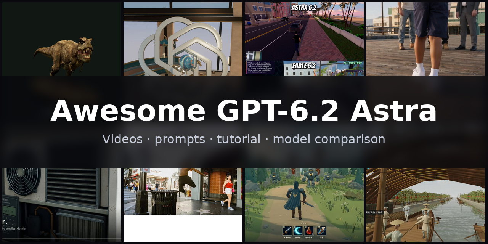](https://www.sandbase.ai/lab/ai-videos/gpt-6-2-astra?lang=zh-CN&utm_source=github&utm_medium=readme&utm_campaign=awesome-gpt-6-2-astra&utm_content=banner)

精选 **GPT-6.2 Astra 案例**合集：用 GPT-6.2 Astra（OpenAI 模型，2026 年 11 月 1 日宣布）做出的视频、提示词和演示。包括 Three.js 与 WebGPU 3D 场景、动效、产品界面、游戏和讲解，均注明作者并链接原帖。模型写的是代码，每条视频都是页面播放时录下的画面。

共 **106 条视频**，来自 **82 位创作者** · **10 条**附作者提示词 · 每天从 [SandBase Lab](https://www.sandbase.ai/lab/ai-videos/gpt-6-2-astra?lang=zh-CN&utm_source=github&utm_medium=readme&utm_campaign=awesome-gpt-6-2-astra&utm_content=stats) 同步

## 从这里开始

| 我想… | 去这里 |
|---|---|
| 看视频 | 在下方 [按分类浏览](#contents)，或 [在 SandBase Lab 大屏播放](https://www.sandbase.ai/lab/ai-videos/gpt-6-2-astra?lang=zh-CN&utm_source=github&utm_medium=readme&utm_campaign=awesome-gpt-6-2-astra&utm_content=quickstart) |
| 复制提示词 | [提示词索引](docs/zh-CN/prompts.md)：所有附带提示词的视频 |
| 自己写提示词 | [提示词写法](docs/zh-CN/prompt-guide.md)：2 条写法和一个填空模板 |
| 做一个视频 | [教程](docs/zh-CN/tutorial.md)：提示词 → HTML → MP4，含 API、CLI 调用和录屏脚本 |
| 选模型 | [GPT-6.2 Astra 对比 Fable 5.5 和 Claude Opus 5.5](docs/zh-CN/model-comparison.md) |
| 马上试试 | [在 Lab 竞技场运行 GPT-6.2 Astra](https://www.sandbase.ai/arena/text?models=openai%2Fgpt-6.2-astra&lang=zh-CN&utm_source=github&utm_medium=readme&utm_campaign=awesome-gpt-6-2-astra&utm_content=quickstart)，和其他模型并排对比 |

<a id="contents"></a>

## 目录

- [精选](#featured) (8)
- [3D 场景](#3d-scene) (18)
- [动效](#motion-graphics) (18)
- [游戏](#game) (13)
- [产品界面](#ui-demo) (3)
- [粒子与形状](#particles) (1)
- [图表图解](#data-viz) (1)
- [讲解](#explainer) (5)
- [测试对比](#comparison) (47)
- [用 GPT-6.2 Astra 复刻视频](#recreate)
- [常见问题](#faq)
- [推荐作品](#contribute)

点击预览图播放视频；点击标题前往 SandBase Lab 查看原帖、提示词，并一键 **复刻**；**@作者** 链接到 X 原帖。

<a id="featured"></a>

## 精选

<table>
<tr><td width="33%" valign="top"><a href="https://www.sandbase.ai/lab/media/x/gpt-6-2-astra/2122755434758967623/video.mp4">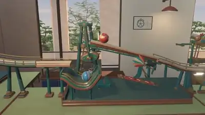</a><br><a href="https://www.sandbase.ai/lab/ai-videos/gpt-6-2-astra/2122755434758967623?lang=zh-CN&utm_source=github&utm_medium=readme&utm_campaign=awesome-gpt-6-2-astra&utm_content=card"><b>基于WebGPU的浏览器3D图形演示</b></a><br><sub><a href="https://x.com/pvncher/status/2122755434758967623">@pvncher</a> · 0:49</sub></td><td width="33%" valign="top"><a href="https://www.sandbase.ai/lab/media/x/gpt-6-2-astra/2122797438326943962/video.mp4">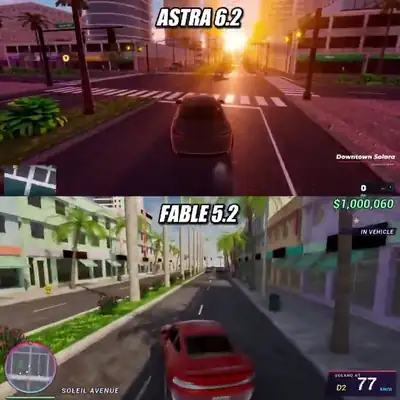</a><br><a href="https://www.sandbase.ai/lab/ai-videos/gpt-6-2-astra/2122797438326943962?lang=zh-CN&utm_source=github&utm_medium=readme&utm_campaign=awesome-gpt-6-2-astra&utm_content=card"><b>类 GTA 开放世界可玩游戏原型</b></a><br><sub><a href="https://x.com/ericmaskfr/status/2122797438326943962">@ericmaskfr</a> · 2:12</sub></td><td width="33%" valign="top"><a href="https://www.sandbase.ai/lab/media/x/gpt-6-2-astra/2122753859281928626/video.mp4">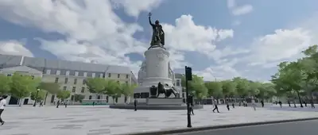</a><br><a href="https://www.sandbase.ai/lab/ai-videos/gpt-6-2-astra/2122753859281928626?lang=zh-CN&utm_source=github&utm_medium=readme&utm_campaign=awesome-gpt-6-2-astra&utm_content=card"><b>1比1还原的巴黎3D交互地图</b></a><br><sub><a href="https://x.com/Dimillian/status/2122753859281928626">@Dimillian</a> · 0:30</sub></td></tr>
<tr><td width="33%" valign="top"><a href="https://www.sandbase.ai/lab/media/x/gpt-6-2-astra/2118163378891805134/video.mp4">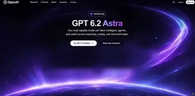</a><br><a href="https://www.sandbase.ai/lab/ai-videos/gpt-6-2-astra/2118163378891805134?lang=zh-CN&utm_source=github&utm_medium=readme&utm_campaign=awesome-gpt-6-2-astra&utm_content=card"><b>生成的GPT-6.2 Astra发布页面动效</b></a><br><sub><a href="https://x.com/Layton_Gott/status/2118163378891805134">@Layton_Gott</a> · 0:07</sub></td><td width="33%" valign="top"><a href="https://www.sandbase.ai/lab/media/x/fable-5-2/2122800630268080599/video.mp4">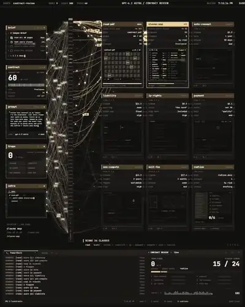</a><br><a href="https://www.sandbase.ai/lab/ai-videos/gpt-6-2-astra/2122800630268080599?lang=zh-CN&utm_source=github&utm_medium=readme&utm_campaign=awesome-gpt-6-2-astra&utm_content=card"><b>使用 AI 进行六十页合同审查演示</b></a><br><sub><a href="https://x.com/mika_systems/status/2122800630268080599">@mika_systems</a> · 0:26</sub></td><td width="33%" valign="top"><a href="https://www.sandbase.ai/lab/media/x/gpt-6-2-astra/2123122214468010183/video.mp4"></a><br><a href="https://www.sandbase.ai/lab/ai-videos/gpt-6-2-astra/2123122214468010183?lang=zh-CN&utm_source=github&utm_medium=readme&utm_campaign=awesome-gpt-6-2-astra&utm_content=card"><b>GTA风格素材拼接制作视频</b></a><br><sub><a href="https://x.com/thetripathi58/status/2123122214468010183">@thetripathi58</a> · 0:30</sub></td></tr>
<tr><td width="33%" valign="top"><a href="https://www.sandbase.ai/lab/media/x/gpt-6-2-astra/2121651873430052967/video.mp4">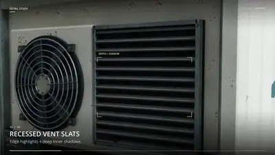</a><br><a href="https://www.sandbase.ai/lab/ai-videos/gpt-6-2-astra/2121651873430052967?lang=zh-CN&utm_source=github&utm_medium=readme&utm_campaign=awesome-gpt-6-2-astra&utm_content=card"><b>从零生成的游戏占位场景</b></a><br><sub><a href="https://x.com/TokenGremlin/status/2121651873430052967">@TokenGremlin</a> · 0:25</sub></td><td width="33%" valign="top"><a href="https://www.sandbase.ai/lab/media/x/gpt-6-2-astra/2123121331281723751/video.mp4">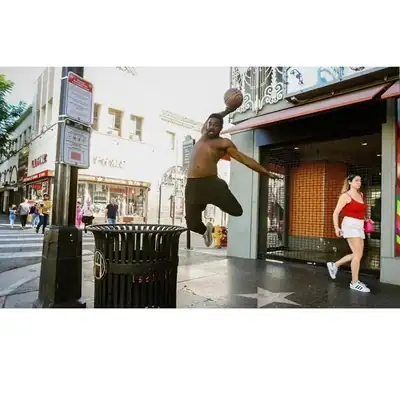</a><br><a href="https://www.sandbase.ai/lab/ai-videos/gpt-6-2-astra/2123121331281723751?lang=zh-CN&utm_source=github&utm_medium=readme&utm_campaign=awesome-gpt-6-2-astra&utm_content=card"><b>手机相册照片转换为GTA加载画面视频</b></a><br><sub><a href="https://x.com/viipin8/status/2123121331281723751">@viipin8</a> · 0:07</sub></td></tr>
</table>

<a id="3d-scene"></a>

## 3D 场景

<table>
<tr><td width="33%" valign="top"><a href="https://www.sandbase.ai/lab/media/x/gpt-6-2-astra/2117224524236181525/video.mp4">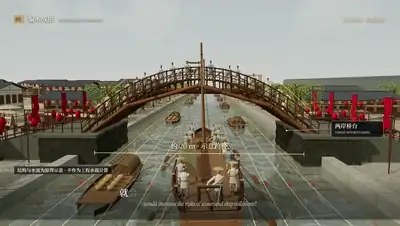</a><br><a href="https://www.sandbase.ai/lab/ai-videos/gpt-6-2-astra/2117224524236181525?lang=zh-CN&utm_source=github&utm_medium=readme&utm_campaign=awesome-gpt-6-2-astra&utm_content=card"><b>Three.js纯代码呈现清明上河图</b></a><br><sub><a href="https://x.com/YFeng2022/status/2117224524236181525">@YFeng2022</a> · 3:37</sub></td><td width="33%" valign="top"><a href="https://www.sandbase.ai/lab/media/x/gpt-6-2-astra/2117913354073448738/video.mp4">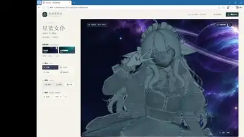</a><br><a href="https://www.sandbase.ai/lab/ai-videos/gpt-6-2-astra/2117913354073448738?lang=zh-CN&utm_source=github&utm_medium=readme&utm_campaign=awesome-gpt-6-2-astra&utm_content=card"><b>由正面单图生成的3D动漫模型</b></a><br><sub><a href="https://x.com/MemoonKun/status/2117913354073448738">@MemoonKun</a> · 0:30</sub></td><td width="33%" valign="top"><a href="https://www.sandbase.ai/lab/media/x/gpt-6-2-astra/2117924044439712156/video.mp4">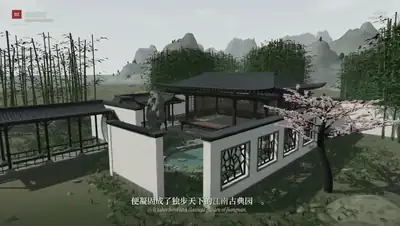</a><br><a href="https://www.sandbase.ai/lab/ai-videos/gpt-6-2-astra/2117924044439712156?lang=zh-CN&utm_source=github&utm_medium=readme&utm_campaign=awesome-gpt-6-2-astra&utm_content=card"><b>Three.js纯代码渲染的中国美学3D场景</b></a><br><sub><a href="https://x.com/YFeng2022/status/2117924044439712156">@YFeng2022</a> · 3:28</sub></td></tr>
<tr><td width="33%" valign="top"><a href="https://www.sandbase.ai/lab/media/x/gpt-6-2-astra/2119289814222614575/video.mp4">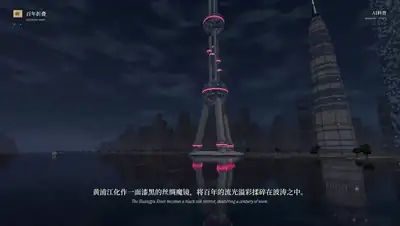</a><br><a href="https://www.sandbase.ai/lab/ai-videos/gpt-6-2-astra/2119289814222614575?lang=zh-CN&utm_source=github&utm_medium=readme&utm_campaign=awesome-gpt-6-2-astra&utm_content=card"><b>Three.js纯代码渲染上海夜景</b></a><br><sub><a href="https://x.com/YFeng2022/status/2119289814222614575">@YFeng2022</a> · 1:48</sub></td><td width="33%" valign="top"><a href="https://www.sandbase.ai/lab/media/x/gpt-6-2-astra/2119407085251170617/video.mp4">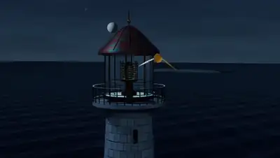</a><br><a href="https://www.sandbase.ai/lab/ai-videos/gpt-6-2-astra/2119407085251170617?lang=zh-CN&utm_source=github&utm_medium=readme&utm_campaign=awesome-gpt-6-2-astra&utm_content=card"><b>使用Vork引擎创建的3D灯塔</b></a><br><sub><a href="https://x.com/rubenssoto_ai/status/2119407085251170617">@rubenssoto_ai</a> · 0:30</sub></td><td width="33%" valign="top"><a href="https://www.sandbase.ai/lab/media/x/gpt-6-2-astra/2119424014640726035/video.mp4">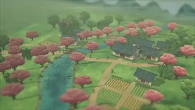</a><br><a href="https://www.sandbase.ai/lab/ai-videos/gpt-6-2-astra/2119424014640726035?lang=zh-CN&utm_source=github&utm_medium=readme&utm_campaign=awesome-gpt-6-2-astra&utm_content=card"><b>单HTML文件中的Three.js村庄场景</b></a><br><sub><a href="https://x.com/dedene/status/2119424014640726035">@dedene</a> · 0:05</sub></td></tr>
</table>

<details>
<summary><b>展开全部 18 条</b></summary>

<table>
<tr><td width="33%" valign="top"><a href="https://www.sandbase.ai/lab/media/x/gpt-6-2-astra/2119521331637285138/video.mp4">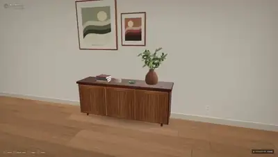</a><br><a href="https://www.sandbase.ai/lab/ai-videos/gpt-6-2-astra/2119521331637285138?lang=zh-CN&utm_source=github&utm_medium=readme&utm_campaign=awesome-gpt-6-2-astra&utm_content=card"><b>厨房场景生成测试</b></a><br><sub><a href="https://x.com/mirochill/status/2119521331637285138">@mirochill</a> · 0:44</sub></td><td width="33%" valign="top"><a href="https://www.sandbase.ai/lab/media/x/gpt-6-2-astra/2121083423960035363/video.mp4"></a><br><a href="https://www.sandbase.ai/lab/ai-videos/gpt-6-2-astra/2121119726743302493?lang=zh-CN&utm_source=github&utm_medium=readme&utm_campaign=awesome-gpt-6-2-astra&utm_content=card"><b>千只鹈鹕在城市街道骑自行车</b></a><br><sub><a href="https://x.com/huagechen/status/2121119726743302493">@huagechen</a> · 1:00</sub></td><td width="33%" valign="top"><a href="https://www.sandbase.ai/lab/media/x/gpt-6-2-astra/2121198245191770551/video.mp4">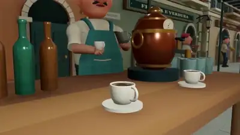</a><br><a href="https://www.sandbase.ai/lab/ai-videos/gpt-6-2-astra/2121198245191770551?lang=zh-CN&utm_source=github&utm_medium=readme&utm_campaign=awesome-gpt-6-2-astra&utm_content=card"><b>千只鹈鹕骑行城市主干道的集群模拟</b></a><br><sub><a href="https://x.com/KOF97AI/status/2121198245191770551">@KOF97AI</a> · 1:00</sub></td></tr>
<tr><td width="33%" valign="top"><a href="https://www.sandbase.ai/lab/media/x/fable-5-2/2122354002373619755/video.mp4">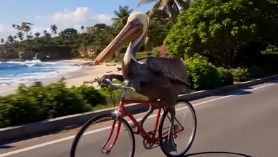</a><br><a href="https://www.sandbase.ai/lab/ai-videos/gpt-6-2-astra/2122354002373619755?lang=zh-CN&utm_source=github&utm_medium=readme&utm_campaign=awesome-gpt-6-2-astra&utm_content=card"><b>鹈鹕在海边骑自行车的测试视频</b></a><br><sub><a href="https://x.com/Yuziyyaa/status/2122354002373619755">@Yuziyyaa</a> · 0:10</sub></td><td width="33%" valign="top"><a href="https://www.sandbase.ai/lab/media/x/gpt-6-2-astra/2122753859281928626/video.mp4"></a><br><a href="https://www.sandbase.ai/lab/ai-videos/gpt-6-2-astra/2122753859281928626?lang=zh-CN&utm_source=github&utm_medium=readme&utm_campaign=awesome-gpt-6-2-astra&utm_content=card"><b>1比1还原的巴黎3D交互地图</b></a><br><sub><a href="https://x.com/Dimillian/status/2122753859281928626">@Dimillian</a> · 0:30</sub></td><td width="33%" valign="top"><a href="https://www.sandbase.ai/lab/media/x/gpt-6-2-astra/2122755434758967623/video.mp4"></a><br><a href="https://www.sandbase.ai/lab/ai-videos/gpt-6-2-astra/2122755434758967623?lang=zh-CN&utm_source=github&utm_medium=readme&utm_campaign=awesome-gpt-6-2-astra&utm_content=card"><b>基于WebGPU的浏览器3D图形演示</b></a><br><sub><a href="https://x.com/pvncher/status/2122755434758967623">@pvncher</a> · 0:49</sub></td></tr>
<tr><td width="33%" valign="top"><a href="https://www.sandbase.ai/lab/media/x/gpt-6-2-astra/2122773415350419806/video.mp4">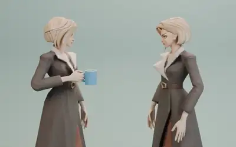</a><br><a href="https://www.sandbase.ai/lab/ai-videos/gpt-6-2-astra/2122773415350419806?lang=zh-CN&utm_source=github&utm_medium=readme&utm_campaign=awesome-gpt-6-2-astra&utm_content=card"><b>3D角色动作动画测试</b></a><br><sub><a href="https://x.com/Arina_tishina/status/2122773415350419806">@Arina_tishina</a> · 0:06</sub></td><td width="33%" valign="top"><a href="https://www.sandbase.ai/lab/media/x/gpt-6-2-astra/2122779376769171510/video.mp4">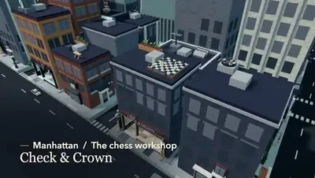</a><br><a href="https://www.sandbase.ai/lab/ai-videos/gpt-6-2-astra/2122779376769171510?lang=zh-CN&utm_source=github&utm_medium=readme&utm_campaign=awesome-gpt-6-2-astra&utm_content=card"><b>使用Blender制作的纽约3D城市图集</b></a><br><sub><a href="https://x.com/DeryaTR_/status/2122779376769171510">@DeryaTR_</a> · 2:00</sub></td><td width="33%" valign="top"><a href="https://www.sandbase.ai/lab/media/x/gpt-6-2-astra/2122790354781192518/video.mp4">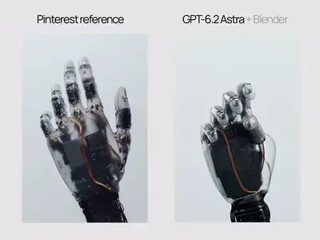</a><br><a href="https://www.sandbase.ai/lab/ai-videos/gpt-6-2-astra/2122790354781192518?lang=zh-CN&utm_source=github&utm_medium=readme&utm_campaign=awesome-gpt-6-2-astra&utm_content=card"><b>Blender中的3D建模与动态测试</b></a><br><sub><a href="https://x.com/AmirMushich/status/2122790354781192518">@AmirMushich</a> · 0:12</sub></td></tr>
<tr><td width="33%" valign="top"><a href="https://www.sandbase.ai/lab/media/x/gpt-6-2-astra/2122854206709051691/video.mp4">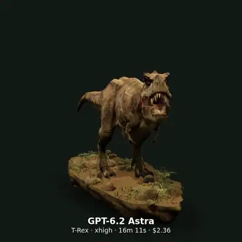</a><br><a href="https://www.sandbase.ai/lab/ai-videos/gpt-6-2-astra/2122854206709051691?lang=zh-CN&utm_source=github&utm_medium=readme&utm_campaign=awesome-gpt-6-2-astra&utm_content=card"><b>尝试构建3D霸王龙模型</b></a><br><sub><a href="https://x.com/luckeyfaraday/status/2122854206709051691">@luckeyfaraday</a> · 0:10</sub></td><td width="33%" valign="top"><a href="https://www.sandbase.ai/lab/media/x/gpt-6-2-astra/2123038188553777549/video.mp4">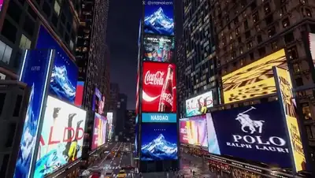</a><br><a href="https://www.sandbase.ai/lab/ai-videos/gpt-6-2-astra/2123038188553777549?lang=zh-CN&utm_source=github&utm_medium=readme&utm_campaign=awesome-gpt-6-2-astra&utm_content=card"><b>Three.js打造的交互式3D时代广场</b></a><br><sub><a href="https://x.com/monokern/status/2123038188553777549">@monokern</a> · 0:30</sub></td><td width="33%" valign="top"><a href="https://www.sandbase.ai/lab/media/x/gpt-6-2-astra/2123064070660325592/video.mp4"></a><br><a href="https://www.sandbase.ai/lab/ai-videos/gpt-6-2-astra/2123064070660325592?lang=zh-CN&utm_source=github&utm_medium=readme&utm_campaign=awesome-gpt-6-2-astra&utm_content=card"><b>Three.js程序化宝塔桥门与水面</b></a><br><sub><a href="https://x.com/srikanthvaluri/status/2123064070660325592">@srikanthvaluri</a> · 0:24</sub></td></tr>
</table>

</details>

<a id="motion-graphics"></a>

## 动效

<table>
<tr><td width="33%" valign="top"><a href="https://www.sandbase.ai/lab/media/x/gpt-6-2-astra/2117234394943586473/video.mp4">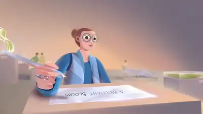</a><br><a href="https://www.sandbase.ai/lab/ai-videos/gpt-6-2-astra/2117234394943586473?lang=zh-CN&utm_source=github&utm_medium=readme&utm_campaign=awesome-gpt-6-2-astra&utm_content=card"><b>归因于GPT-6.2 Astra的视频展示</b></a><br><sub><a href="https://x.com/gadi_neelesh/status/2117234394943586473">@gadi_neelesh</a> · 1:17</sub></td><td width="33%" valign="top"><a href="https://www.sandbase.ai/lab/media/x/gpt-6-2-astra/2117242834017497336/video.mp4"></a><br><a href="https://www.sandbase.ai/lab/ai-videos/gpt-6-2-astra/2117242834017497336?lang=zh-CN&utm_source=github&utm_medium=readme&utm_campaign=awesome-gpt-6-2-astra&utm_content=card"><b>纯代码生成的带音效动画短片</b></a><br><sub><a href="https://x.com/badboyfoxy/status/2117242834017497336">@badboyfoxy</a> · 0:58</sub></td><td width="33%" valign="top"><a href="https://www.sandbase.ai/lab/media/x/gpt-6-2-astra/2117263042329370877/video.mp4">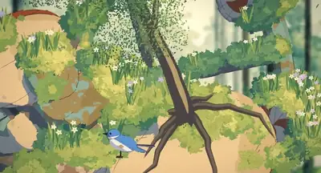</a><br><a href="https://www.sandbase.ai/lab/ai-videos/gpt-6-2-astra/2117263042329370877?lang=zh-CN&utm_source=github&utm_medium=readme&utm_campaign=awesome-gpt-6-2-astra&utm_content=card"><b>纯代码生成的动画效果演示</b></a><br><sub><a href="https://x.com/Smlay_ero/status/2117263042329370877">@Smlay_ero</a> · 1:21</sub></td></tr>
<tr><td width="33%" valign="top"><a href="https://www.sandbase.ai/lab/media/x/gpt-6-2-astra/2117289480608460897/video.mp4">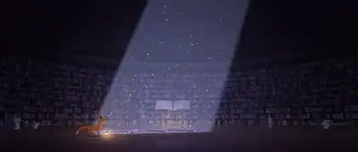</a><br><a href="https://www.sandbase.ai/lab/ai-videos/gpt-6-2-astra/2117289480608460897?lang=zh-CN&utm_source=github&utm_medium=readme&utm_campaign=awesome-gpt-6-2-astra&utm_content=card"><b>纯代码复刻生成的动画短片</b></a><br><sub><a href="https://x.com/marcthecreatorr/status/2117289480608460897">@marcthecreatorr</a> · 0:58</sub></td><td width="33%" valign="top"><a href="https://www.sandbase.ai/lab/media/x/gpt-6-2-astra/2117591011388010548/video.mp4"></a><br><a href="https://www.sandbase.ai/lab/ai-videos/gpt-6-2-astra/2117591011388010548?lang=zh-CN&utm_source=github&utm_medium=readme&utm_campaign=awesome-gpt-6-2-astra&utm_content=card"><b>GPT-6.2 Astra自主生成的视频</b></a><br><sub><a href="https://x.com/TokenGremlin/status/2117591011388010548">@TokenGremlin</a> · 0:10</sub></td><td width="33%" valign="top"><a href="https://www.sandbase.ai/lab/media/x/gpt-6-2-astra/2117987734380011727/video.mp4">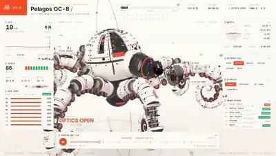</a><br><a href="https://www.sandbase.ai/lab/ai-videos/gpt-6-2-astra/2117987734380011727?lang=zh-CN&utm_source=github&utm_medium=readme&utm_campaign=awesome-gpt-6-2-astra&utm_content=card"><b>GPT-6.2 Astra自主生成的视频</b></a><br><sub><a href="https://x.com/JamesMalsawm/status/2117987734380011727">@JamesMalsawm</a> · 0:23</sub></td></tr>
</table>

<details>
<summary><b>展开全部 18 条</b></summary>

<table>
<tr><td width="33%" valign="top"><a href="https://www.sandbase.ai/lab/media/x/gpt-6-2-astra/2118016475696894413/video.mp4">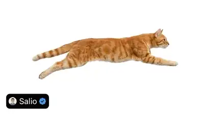</a><br><a href="https://www.sandbase.ai/lab/ai-videos/gpt-6-2-astra/2118016475696894413?lang=zh-CN&utm_source=github&utm_medium=readme&utm_campaign=awesome-gpt-6-2-astra&utm_content=card"><b>GPT-6.2 Astra制作的写实猫咪SVG</b></a><br><sub><a href="https://x.com/R2Cdev_/status/2118016475696894413">@R2Cdev_</a> · 0:06</sub></td><td width="33%" valign="top"><a href="https://www.sandbase.ai/lab/media/x/gpt-6-2-astra/2118366708096549202/video.mp4">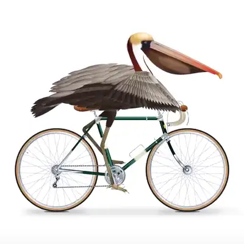</a><br><a href="https://www.sandbase.ai/lab/ai-videos/gpt-6-2-astra/2118366708096549202?lang=zh-CN&utm_source=github&utm_medium=readme&utm_campaign=awesome-gpt-6-2-astra&utm_content=card"><b>纯SVG制作的鹈鹕蹬车动画</b></a><br><sub><a href="https://x.com/Adidotdev/status/2118366708096549202">@Adidotdev</a> · 0:10</sub></td><td width="33%" valign="top"><a href="https://www.sandbase.ai/lab/media/x/gpt-6-2-astra/2119399538792521828/video.mp4">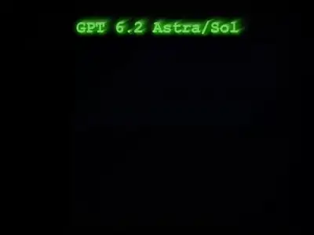</a><br><a href="https://www.sandbase.ai/lab/ai-videos/gpt-6-2-astra/2119399538792521828?lang=zh-CN&utm_source=github&utm_medium=readme&utm_campaign=awesome-gpt-6-2-astra&utm_content=card"><b>单次生成的FAAAH动态图形</b></a><br><sub><a href="https://x.com/ritu_twts/status/2119399538792521828">@ritu_twts</a> · 0:13</sub></td></tr>
<tr><td width="33%" valign="top"><a href="https://www.sandbase.ai/lab/media/x/gpt-6-2-astra/2120625322823684444/video.mp4"></a><br><a href="https://www.sandbase.ai/lab/ai-videos/gpt-6-2-astra/2120625322823684444?lang=zh-CN&utm_source=github&utm_medium=readme&utm_campaign=awesome-gpt-6-2-astra&utm_content=card"><b>纯JavaScript制作的动画与AI期望清单</b></a><br><sub><a href="https://x.com/pradeepXkapoor/status/2120625322823684444">@pradeepXkapoor</a> · 0:30</sub></td><td width="33%" valign="top"><a href="https://www.sandbase.ai/lab/media/x/gpt-6-2-astra/2121567830181331194/video.mp4"></a><br><a href="https://www.sandbase.ai/lab/ai-videos/gpt-6-2-astra/2121567830181331194?lang=zh-CN&utm_source=github&utm_medium=readme&utm_campaign=awesome-gpt-6-2-astra&utm_content=card"><b>水面上行驶的船只动画</b></a><br><sub><a href="https://x.com/SiftByte/status/2121567830181331194">@SiftByte</a> · 0:08</sub></td><td width="33%" valign="top"><a href="https://www.sandbase.ai/lab/media/x/gpt-6-2-astra/2122761102870138956/video.mp4">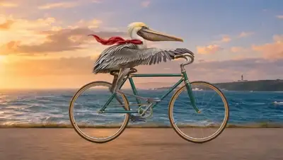</a><br><a href="https://www.sandbase.ai/lab/ai-videos/gpt-6-2-astra/2122761102870138956?lang=zh-CN&utm_source=github&utm_medium=readme&utm_campaign=awesome-gpt-6-2-astra&utm_content=card"><b>沿海岸骑自行车的鹈鹕动画</b></a><br><sub><a href="https://x.com/yangzhong01/status/2122761102870138956">@yangzhong01</a> · 0:12</sub></td></tr>
<tr><td width="33%" valign="top"><a href="https://www.sandbase.ai/lab/media/x/gpt-6-2-astra/2122778264959902166/video.mp4">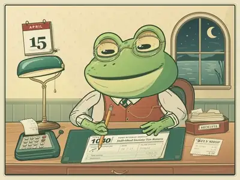</a><br><a href="https://www.sandbase.ai/lab/ai-videos/gpt-6-2-astra/2122778264959902166?lang=zh-CN&utm_source=github&utm_medium=readme&utm_campaign=awesome-gpt-6-2-astra&utm_content=card"><b>报税青蛙SVG动画</b></a><br><sub><a href="https://x.com/Ananth7e/status/2122778264959902166">@Ananth7e</a> · 0:15</sub></td><td width="33%" valign="top"><a href="https://www.sandbase.ai/lab/media/x/gpt-6-2-astra/2122804327857184793/video.mp4"></a><br><a href="https://www.sandbase.ai/lab/ai-videos/gpt-6-2-astra/2122804327857184793?lang=zh-CN&utm_source=github&utm_medium=readme&utm_campaign=awesome-gpt-6-2-astra&utm_content=card"><b>实时逐像素视频编辑效果演示</b></a><br><sub><a href="https://x.com/xiathis/status/2122804327857184793">@xiathis</a> · 0:28</sub></td><td width="33%" valign="top"><a href="https://www.sandbase.ai/lab/media/x/gpt-6-2-astra/2122816629402910859/video.mp4">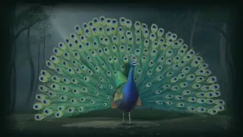</a><br><a href="https://www.sandbase.ai/lab/ai-videos/gpt-6-2-astra/2122816629402910859?lang=zh-CN&utm_source=github&utm_medium=readme&utm_campaign=awesome-gpt-6-2-astra&utm_content=card"><b>孔雀的精细矢量SVG动画</b></a><br><sub><a href="https://x.com/petergostev/status/2122816629402910859">@petergostev</a> · 0:55</sub></td></tr>
<tr><td width="33%" valign="top"><a href="https://www.sandbase.ai/lab/media/x/gpt-6-2-astra/2123121331281723751/video.mp4"></a><br><a href="https://www.sandbase.ai/lab/ai-videos/gpt-6-2-astra/2123121331281723751?lang=zh-CN&utm_source=github&utm_medium=readme&utm_campaign=awesome-gpt-6-2-astra&utm_content=card"><b>手机相册照片转换为GTA加载画面视频</b></a><br><sub><a href="https://x.com/viipin8/status/2123121331281723751">@viipin8</a> · 0:07</sub></td><td width="33%" valign="top"><a href="https://www.sandbase.ai/lab/media/x/gpt-6-2-astra/2123122214468010183/video.mp4"></a><br><a href="https://www.sandbase.ai/lab/ai-videos/gpt-6-2-astra/2123122214468010183?lang=zh-CN&utm_source=github&utm_medium=readme&utm_campaign=awesome-gpt-6-2-astra&utm_content=card"><b>GTA风格素材拼接制作视频</b></a><br><sub><a href="https://x.com/thetripathi58/status/2123122214468010183">@thetripathi58</a> · 0:30</sub></td><td width="33%" valign="top"><a href="https://www.sandbase.ai/lab/media/x/gpt-6-2-astra/2123151320987365603/video.mp4">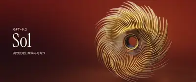</a><br><a href="https://www.sandbase.ai/lab/ai-videos/gpt-6-2-astra/2123151320987365603?lang=zh-CN&utm_source=github&utm_medium=readme&utm_campaign=awesome-gpt-6-2-astra&utm_content=card"><b>使用最大推理强度生成的视频</b></a><br><sub><a href="https://x.com/minatoish/status/2123151320987365603">@minatoish</a> · 0:52</sub></td></tr>
</table>

</details>

<a id="game"></a>

## 游戏

<table>
<tr><td width="33%" valign="top"><a href="https://www.sandbase.ai/lab/media/x/gpt-6-2-astra/2116895719248536032/video.mp4">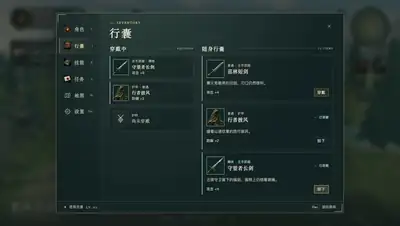</a><br><a href="https://www.sandbase.ai/lab/ai-videos/gpt-6-2-astra/2116895719248536032?lang=zh-CN&utm_source=github&utm_medium=readme&utm_campaign=awesome-gpt-6-2-astra&utm_content=card"><b>单提示词生成的3D角色扮演游戏</b></a><br><sub><a href="https://x.com/karanC_12/status/2116895719248536032">@karanC_12</a> · 0:57</sub></td><td width="33%" valign="top"><a href="https://www.sandbase.ai/lab/media/x/gpt-6-2-astra/2117651236589797572/video.mp4">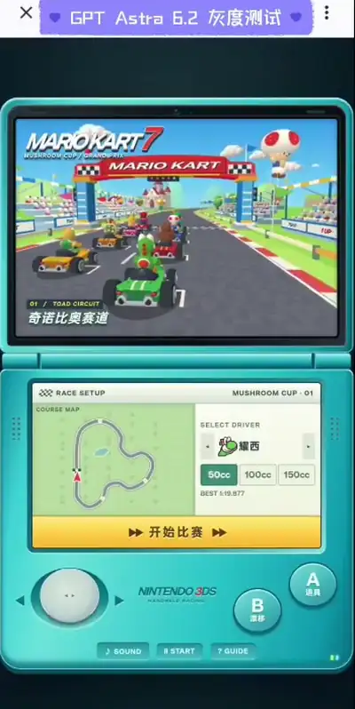</a><br><a href="https://www.sandbase.ai/lab/ai-videos/gpt-6-2-astra/2117651236589797572?lang=zh-CN&utm_source=github&utm_medium=readme&utm_campaign=awesome-gpt-6-2-astra&utm_content=card"><b>移动端马里奥赛车克隆游戏</b></a><br><sub><a href="https://x.com/Smlay_ero/status/2117651236589797572">@Smlay_ero</a> · 0:56</sub></td><td width="33%" valign="top"><a href="https://www.sandbase.ai/lab/media/x/gpt-6-2-astra/2118310499213312478/video.mp4">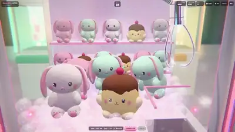</a><br><a href="https://www.sandbase.ai/lab/ai-videos/gpt-6-2-astra/2118310499213312478?lang=zh-CN&utm_source=github&utm_medium=readme&utm_campaign=awesome-gpt-6-2-astra&utm_content=card"><b>基于Three.js制作的3D抓娃娃机游戏</b></a><br><sub><a href="https://x.com/RenaRoze_doll/status/2118310499213312478">@RenaRoze_doll</a> · 0:32</sub></td></tr>
<tr><td width="33%" valign="top"><a href="https://www.sandbase.ai/lab/media/x/gpt-6-2-astra/2121651873430052967/video.mp4"></a><br><a href="https://www.sandbase.ai/lab/ai-videos/gpt-6-2-astra/2121651873430052967?lang=zh-CN&utm_source=github&utm_medium=readme&utm_campaign=awesome-gpt-6-2-astra&utm_content=card"><b>从零生成的游戏占位场景</b></a><br><sub><a href="https://x.com/TokenGremlin/status/2121651873430052967">@TokenGremlin</a> · 0:25</sub></td><td width="33%" valign="top"><a href="https://www.sandbase.ai/lab/media/x/gpt-6-2-astra/2122764162124353906/video.mp4">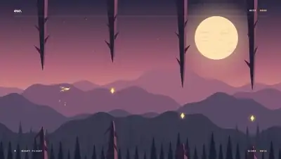</a><br><a href="https://www.sandbase.ai/lab/ai-videos/gpt-6-2-astra/2122764162124353906?lang=zh-CN&utm_source=github&utm_medium=readme&utm_campaign=awesome-gpt-6-2-astra&utm_content=card"><b>六十秒内生成的游戏演示</b></a><br><sub><a href="https://x.com/Ananth7e/status/2122764162124353906">@Ananth7e</a> · 0:30</sub></td><td width="33%" valign="top"><a href="https://www.sandbase.ai/lab/media/x/gpt-6-2-astra/2122781234191319492/video.mp4">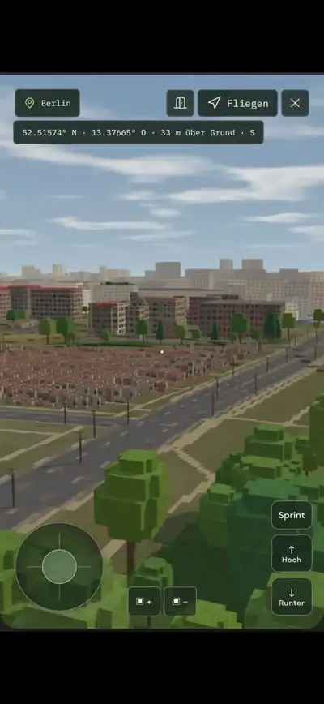</a><br><a href="https://www.sandbase.ai/lab/ai-videos/gpt-6-2-astra/2122781234191319492?lang=zh-CN&utm_source=github&utm_medium=readme&utm_campaign=awesome-gpt-6-2-astra&utm_content=card"><b>浏览器中可交互的方块版德国</b></a><br><sub><a href="https://x.com/VraserX/status/2122781234191319492">@VraserX</a> · 0:45</sub></td></tr>
</table>

<details>
<summary><b>展开全部 13 条</b></summary>

<table>
<tr><td width="33%" valign="top"><a href="https://www.sandbase.ai/lab/media/x/gpt-6-2-astra/2122788211735048348/video.mp4">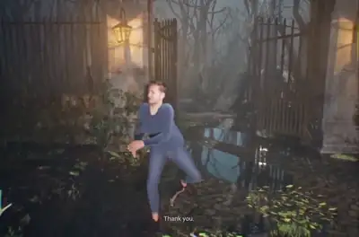</a><br><a href="https://www.sandbase.ai/lab/ai-videos/gpt-6-2-astra/2122788211735048348?lang=zh-CN&utm_source=github&utm_medium=readme&utm_campaign=awesome-gpt-6-2-astra&utm_content=card"><b>游戏场景中的NPC逼真手势改进</b></a><br><sub><a href="https://x.com/MrCollison/status/2122788211735048348">@MrCollison</a> · 1:21 · <a href="https://www.sandbase.ai/lab/ai-videos/gpt-6-2-astra/2122788211735048348?lang=zh-CN&utm_source=github&utm_medium=readme&utm_campaign=awesome-gpt-6-2-astra&utm_content=card">提示词</a></sub></td><td width="33%" valign="top"><a href="https://www.sandbase.ai/lab/media/x/gpt-6-2-astra/2122790120759980485/video.mp4">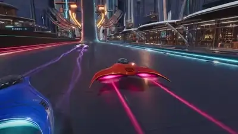</a><br><a href="https://www.sandbase.ai/lab/ai-videos/gpt-6-2-astra/2122790120759980485?lang=zh-CN&utm_source=github&utm_medium=readme&utm_campaign=awesome-gpt-6-2-astra&utm_content=card"><b>在浏览器中运行的悬浮赛车游戏</b></a><br><sub><a href="https://x.com/AnikaCodes/status/2122790120759980485">@AnikaCodes</a> · 1:00</sub></td><td width="33%" valign="top"><a href="https://www.sandbase.ai/lab/media/x/gpt-6-2-astra/2122797438326943962/video.mp4"></a><br><a href="https://www.sandbase.ai/lab/ai-videos/gpt-6-2-astra/2122797438326943962?lang=zh-CN&utm_source=github&utm_medium=readme&utm_campaign=awesome-gpt-6-2-astra&utm_content=card"><b>类 GTA 开放世界可玩游戏原型</b></a><br><sub><a href="https://x.com/ericmaskfr/status/2122797438326943962">@ericmaskfr</a> · 2:12</sub></td></tr>
<tr><td width="33%" valign="top"><a href="https://www.sandbase.ai/lab/media/x/gpt-6-2-astra/2122800268706259244/video.mp4">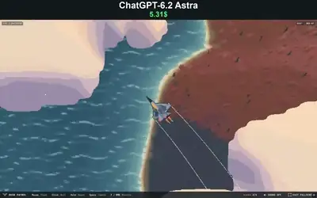</a><br><a href="https://www.sandbase.ai/lab/ai-videos/gpt-6-2-astra/2122800268706259244?lang=zh-CN&utm_source=github&utm_medium=readme&utm_campaign=awesome-gpt-6-2-astra&utm_content=card"><b>单文件像素风喷气机飞行游戏</b></a><br><sub><a href="https://x.com/vib3coded/status/2122800268706259244">@vib3coded</a> · 0:14</sub></td><td width="33%" valign="top"><a href="https://www.sandbase.ai/lab/media/x/gpt-6-2-astra/2123000483342319616/video.mp4">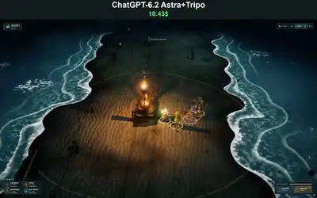</a><br><a href="https://www.sandbase.ai/lab/ai-videos/gpt-6-2-astra/2123000483342319616?lang=zh-CN&utm_source=github&utm_medium=readme&utm_campaign=awesome-gpt-6-2-astra&utm_content=card"><b>包含四名英雄角色的动作游戏原型</b></a><br><sub><a href="https://x.com/vib3coded/status/2123000483342319616">@vib3coded</a> · 0:55</sub></td><td width="33%" valign="top"><a href="https://www.sandbase.ai/lab/media/x/gpt-6-2-astra/2123095557644386526/video.mp4">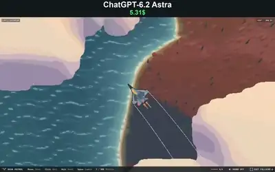</a><br><a href="https://www.sandbase.ai/lab/ai-videos/gpt-6-2-astra/2123095557644386526?lang=zh-CN&utm_source=github&utm_medium=readme&utm_campaign=awesome-gpt-6-2-astra&utm_content=card"><b>HTML单文件像素风喷气战机游戏</b></a><br><sub><a href="https://x.com/EHuanglu/status/2123095557644386526">@EHuanglu</a> · 0:14</sub></td></tr>
<tr><td width="33%" valign="top"><a href="https://www.sandbase.ai/lab/media/x/gpt-6-2-astra/2123140487368642799/video.mp4">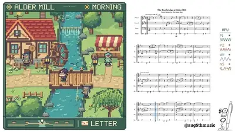</a><br><a href="https://www.sandbase.ai/lab/ai-videos/gpt-6-2-astra/2123140487368642799?lang=zh-CN&utm_source=github&utm_medium=readme&utm_campaign=awesome-gpt-6-2-astra&utm_content=card"><b>Game Boy风格RPG音乐与乐谱视频</b></a><br><sub><a href="https://x.com/aug5thmusic/status/2123140487368642799">@aug5thmusic</a> · 1:47 · <a href="https://www.sandbase.ai/lab/ai-videos/gpt-6-2-astra/2123140487368642799?lang=zh-CN&utm_source=github&utm_medium=readme&utm_campaign=awesome-gpt-6-2-astra&utm_content=card">提示词</a></sub></td></tr>
</table>

</details>

<a id="ui-demo"></a>

## 产品界面

<table>
<tr><td width="33%" valign="top"><a href="https://www.sandbase.ai/lab/media/x/gpt-6-2-astra/2118163378891805134/video.mp4"></a><br><a href="https://www.sandbase.ai/lab/ai-videos/gpt-6-2-astra/2118163378891805134?lang=zh-CN&utm_source=github&utm_medium=readme&utm_campaign=awesome-gpt-6-2-astra&utm_content=card"><b>生成的GPT-6.2 Astra发布页面动效</b></a><br><sub><a href="https://x.com/Layton_Gott/status/2118163378891805134">@Layton_Gott</a> · 0:07</sub></td><td width="33%" valign="top"><a href="https://www.sandbase.ai/lab/media/x/gpt-6-2-astra/2118698617053868062/video.mp4">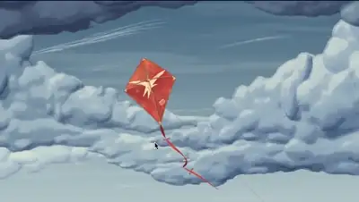</a><br><a href="https://www.sandbase.ai/lab/ai-videos/gpt-6-2-astra/2118698617053868062?lang=zh-CN&utm_source=github&utm_medium=readme&utm_campaign=awesome-gpt-6-2-astra&utm_content=card"><b>带有风筝与日出动画的手绘动漫风网页</b></a><br><sub><a href="https://x.com/learnwithcheer/status/2118698617053868062">@learnwithcheer</a> · 1:00</sub></td><td width="33%" valign="top"><a href="https://www.sandbase.ai/lab/media/x/fable-5-2/2122800630268080599/video.mp4"></a><br><a href="https://www.sandbase.ai/lab/ai-videos/gpt-6-2-astra/2122800630268080599?lang=zh-CN&utm_source=github&utm_medium=readme&utm_campaign=awesome-gpt-6-2-astra&utm_content=card"><b>使用 AI 进行六十页合同审查演示</b></a><br><sub><a href="https://x.com/mika_systems/status/2122800630268080599">@mika_systems</a> · 0:26</sub></td></tr>
</table>

<a id="particles"></a>

## 粒子与形状

<table>
<tr><td width="33%" valign="top"><a href="https://www.sandbase.ai/lab/media/x/gpt-6-2-astra/2122767172091158756/video.mp4">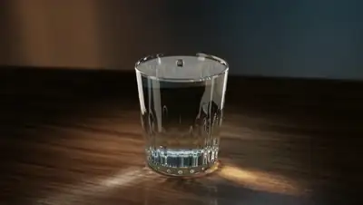</a><br><a href="https://www.sandbase.ai/lab/ai-videos/gpt-6-2-astra/2122767172091158756?lang=zh-CN&utm_source=github&utm_medium=readme&utm_campaign=awesome-gpt-6-2-astra&utm_content=card"><b>二十秒内生成的写实水花效果</b></a><br><sub><a href="https://x.com/LDT0545/status/2122767172091158756">@LDT0545</a> · 0:08</sub></td></tr>
</table>

<a id="data-viz"></a>

## 图表图解

<table>
<tr><td width="33%" valign="top"><a href="https://www.sandbase.ai/lab/media/x/gpt-6-2-astra/2123069779368153121/video.mp4">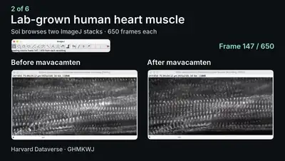</a><br><a href="https://www.sandbase.ai/lab/ai-videos/gpt-6-2-astra/2123069779368153121?lang=zh-CN&utm_source=github&utm_medium=readme&utm_campaign=awesome-gpt-6-2-astra&utm_content=card"><b>ImageJ显微镜数据集自动化分析展示</b></a><br><sub><a href="https://x.com/JacobMolBio/status/2123069779368153121">@JacobMolBio</a> · 2:43</sub></td></tr>
</table>

<a id="explainer"></a>

## 讲解

<table>
<tr><td width="33%" valign="top"><a href="https://www.sandbase.ai/lab/media/x/gpt-6-2-astra/2117730946518745210/video.mp4"></a><br><a href="https://www.sandbase.ai/lab/ai-videos/gpt-6-2-astra/2117730946518745210?lang=zh-CN&utm_source=github&utm_medium=readme&utm_campaign=awesome-gpt-6-2-astra&utm_content=card"><b>社交动态主题的自然纪录片恶搞视频</b></a><br><sub><a href="https://x.com/RezAIT00/status/2117730946518745210">@RezAIT00</a> · 2:19</sub></td><td width="33%" valign="top"><a href="https://www.sandbase.ai/lab/media/x/gpt-6-2-astra/2119811022873575426/video.mp4">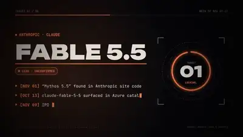</a><br><a href="https://www.sandbase.ai/lab/ai-videos/gpt-6-2-astra/2119811022873575426?lang=zh-CN&utm_source=github&utm_medium=readme&utm_campaign=awesome-gpt-6-2-astra&utm_content=card"><b>探讨即将发布的顶级AI模型</b></a><br><sub><a href="https://x.com/kepochnik/status/2119811022873575426">@kepochnik</a> · 0:36</sub></td><td width="33%" valign="top"><a href="https://www.sandbase.ai/lab/media/x/gpt-6-2-astra/2122759288397681023/video.mp4">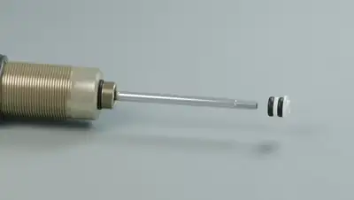</a><br><a href="https://www.sandbase.ai/lab/ai-videos/gpt-6-2-astra/2122759288397681023?lang=zh-CN&utm_source=github&utm_medium=readme&utm_campaign=awesome-gpt-6-2-astra&utm_content=card"><b>遥控越野车组装指南动画</b></a><br><sub><a href="https://x.com/alexmichael/status/2122759288397681023">@alexmichael</a> · 0:33</sub></td></tr>
<tr><td width="33%" valign="top"><a href="https://www.sandbase.ai/lab/media/x/gpt-6-2-astra/2122772868270579949/video.mp4">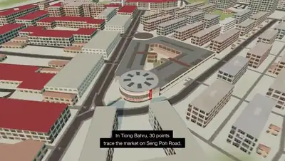</a><br><a href="https://www.sandbase.ai/lab/ai-videos/gpt-6-2-astra/2122772868270579949?lang=zh-CN&utm_source=github&utm_medium=readme&utm_campaign=awesome-gpt-6-2-astra&utm_content=card"><b>讲解如何生成新加坡数字孪生模型</b></a><br><sub><a href="https://x.com/gabrielchua/status/2122772868270579949">@gabrielchua</a> · 1:59</sub></td><td width="33%" valign="top"><a href="https://www.sandbase.ai/lab/media/x/gpt-6-2-astra/2122779945965699148/video.mp4"></a><br><a href="https://www.sandbase.ai/lab/ai-videos/gpt-6-2-astra/2122779945965699148?lang=zh-CN&utm_source=github&utm_medium=readme&utm_campaign=awesome-gpt-6-2-astra&utm_content=card"><b>解析Theo为何反感GPT-6.2 Astra</b></a><br><sub><a href="https://x.com/jithingarapati/status/2122779945965699148">@jithingarapati</a> · 0:29</sub></td></tr>
</table>

<a id="comparison"></a>

## 测试对比

<table>
<tr><td width="33%" valign="top"><a href="https://www.sandbase.ai/lab/media/x/gpt-6-2-astra/2116883000361427433/video.mp4"></a><br><a href="https://www.sandbase.ai/lab/ai-videos/gpt-6-2-astra/2116883000361427433?lang=zh-CN&utm_source=github&utm_medium=readme&utm_campaign=awesome-gpt-6-2-astra&utm_content=card"><b>鹈鹕骑自行车的SVG机械动画</b></a><br><sub><a href="https://x.com/xiax0603/status/2116883000361427433">@xiax0603</a> · 0:39</sub></td><td width="33%" valign="top"><a href="https://www.sandbase.ai/lab/media/x/gpt-6-2-astra/2116902431451918603/video.mp4"></a><br><a href="https://www.sandbase.ai/lab/ai-videos/gpt-6-2-astra/2116902431451918603?lang=zh-CN&utm_source=github&utm_medium=readme&utm_campaign=awesome-gpt-6-2-astra&utm_content=card"><b>Fable 5.5生成的3D鹈鹕渲染场景</b></a><br><sub><a href="https://x.com/Smlay_ero/status/2116902431451918603">@Smlay_ero</a> · 0:16</sub></td><td width="33%" valign="top"><a href="https://www.sandbase.ai/lab/media/x/gpt-6-2-astra/2117210973576765462/video.mp4"></a><br><a href="https://www.sandbase.ai/lab/ai-videos/gpt-6-2-astra/2117210973576765462?lang=zh-CN&utm_source=github&utm_medium=readme&utm_campaign=awesome-gpt-6-2-astra&utm_content=card"><b>两款模型纯前端代码动画生成对比</b></a><br><sub><a href="https://x.com/Smlay_ero/status/2117210973576765462">@Smlay_ero</a> · 1:02</sub></td></tr>
<tr><td width="33%" valign="top"><a href="https://www.sandbase.ai/lab/media/x/gpt-6-2-astra/2117222592536789149/video.mp4"></a><br><a href="https://www.sandbase.ai/lab/ai-videos/gpt-6-2-astra/2117222592536789149?lang=zh-CN&utm_source=github&utm_medium=readme&utm_campaign=awesome-gpt-6-2-astra&utm_content=card"><b>四款大模型生成3D开放世界RPG对比</b></a><br><sub><a href="https://x.com/noclipepe/status/2117222592536789149">@noclipepe</a> · 0:48</sub></td><td width="33%" valign="top"><a href="https://www.sandbase.ai/lab/media/x/gpt-6-2-astra/2117926687048683560/video.mp4"></a><br><a href="https://www.sandbase.ai/lab/ai-videos/gpt-6-2-astra/2117926687048683560?lang=zh-CN&utm_source=github&utm_medium=readme&utm_campaign=awesome-gpt-6-2-astra&utm_content=card"><b>Fable 5.5与Opus 5.5及Astra对比测试</b></a><br><sub><a href="https://x.com/leohuanfang/status/2117926687048683560">@leohuanfang</a> · 0:16</sub></td><td width="33%" valign="top"><a href="https://www.sandbase.ai/lab/media/x/gpt-6-2-astra/2117955030506709468/video.mp4"></a><br><a href="https://www.sandbase.ai/lab/ai-videos/gpt-6-2-astra/2117955030506709468?lang=zh-CN&utm_source=github&utm_medium=readme&utm_campaign=awesome-gpt-6-2-astra&utm_content=card"><b>鹈鹕骑自行车的SVG动画对比</b></a><br><sub><a href="https://x.com/Its_lakshya_ai/status/2117955030506709468">@Its_lakshya_ai</a> · 0:25 · <a href="https://www.sandbase.ai/lab/ai-videos/gpt-6-2-astra/2117955030506709468?lang=zh-CN&utm_source=github&utm_medium=readme&utm_campaign=awesome-gpt-6-2-astra&utm_content=card">提示词</a></sub></td></tr>
</table>

<details>
<summary><b>展开全部 47 条</b></summary>

<table>
<tr><td width="33%" valign="top"><a href="https://www.sandbase.ai/lab/media/x/gpt-6-2-astra/2117973639333298513/video.mp4"></a><br><a href="https://www.sandbase.ai/lab/ai-videos/gpt-6-2-astra/2117973639333298513?lang=zh-CN&utm_source=github&utm_medium=readme&utm_campaign=awesome-gpt-6-2-astra&utm_content=card"><b>动漫风格火柴人打斗动画对比</b></a><br><sub><a href="https://x.com/leohuanfang/status/2117973639333298513">@leohuanfang</a> · 0:13 · <a href="https://www.sandbase.ai/lab/ai-videos/gpt-6-2-astra/2117973639333298513?lang=zh-CN&utm_source=github&utm_medium=readme&utm_campaign=awesome-gpt-6-2-astra&utm_content=card">提示词</a></sub></td><td width="33%" valign="top"><a href="https://www.sandbase.ai/lab/media/x/gpt-6-2-astra/2118581595267539404/video.mp4"></a><br><a href="https://www.sandbase.ai/lab/ai-videos/gpt-6-2-astra/2118581595267539404?lang=zh-CN&utm_source=github&utm_medium=readme&utm_campaign=awesome-gpt-6-2-astra&utm_content=card"><b>GPT-6 Astra首发与当前版本对比</b></a><br><sub><a href="https://x.com/glitch_catAI/status/2118581595267539404">@glitch_catAI</a> · 0:09</sub></td><td width="33%" valign="top"><a href="https://www.sandbase.ai/lab/media/x/gpt-6-2-astra/2119527377109672111/video.mp4"></a><br><a href="https://www.sandbase.ai/lab/ai-videos/gpt-6-2-astra/2119527377109672111?lang=zh-CN&utm_source=github&utm_medium=readme&utm_campaign=awesome-gpt-6-2-astra&utm_content=card"><b>Claude Opus 5.5对比GPT-6 Astra 3D效果</b></a><br><sub><a href="https://x.com/EnvolDev/status/2119527377109672111">@EnvolDev</a> · 0:25</sub></td></tr>
<tr><td width="33%" valign="top"><a href="https://www.sandbase.ai/lab/media/x/gpt-6-2-astra/2122366081948123189/video.mp4"></a><br><a href="https://www.sandbase.ai/lab/ai-videos/gpt-6-2-astra/2122366081948123189?lang=zh-CN&utm_source=github&utm_medium=readme&utm_campaign=awesome-gpt-6-2-astra&utm_content=card"><b>四种AI模型渲染珊瑚礁的对比测试</b></a><br><sub><a href="https://x.com/EnvolDev/status/2122366081948123189">@EnvolDev</a> · 0:25 · <a href="https://www.sandbase.ai/lab/ai-videos/gpt-6-2-astra/2122366081948123189?lang=zh-CN&utm_source=github&utm_medium=readme&utm_campaign=awesome-gpt-6-2-astra&utm_content=card">提示词</a></sub></td><td width="33%" valign="top"><a href="https://www.sandbase.ai/lab/media/x/gpt-6-2-astra/2122753176113688601/video.mp4"></a><br><a href="https://www.sandbase.ai/lab/ai-videos/gpt-6-2-astra/2122753176113688601?lang=zh-CN&utm_source=github&utm_medium=readme&utm_campaign=awesome-gpt-6-2-astra&utm_content=card"><b>五款AI模型挑战维基百科寻路游戏测速</b></a><br><sub><a href="https://x.com/nickbaumann_/status/2122753176113688601">@nickbaumann_</a> · 1:06</sub></td><td width="33%" valign="top"><a href="https://www.sandbase.ai/lab/media/x/gpt-6-2-astra/2122766188933693654/video.mp4"></a><br><a href="https://www.sandbase.ai/lab/ai-videos/gpt-6-2-astra/2122766188933693654?lang=zh-CN&utm_source=github&utm_medium=readme&utm_campaign=awesome-gpt-6-2-astra&utm_content=card"><b>三款模型生成的骑车鹈鹕动画对比</b></a><br><sub><a href="https://x.com/MOPS_PUGS/status/2122766188933693654">@MOPS_PUGS</a> · 0:16</sub></td></tr>
<tr><td width="33%" valign="top"><a href="https://www.sandbase.ai/lab/media/x/gpt-6-2-astra/2122767787068448816/video.mp4"></a><br><a href="https://www.sandbase.ai/lab/ai-videos/gpt-6-2-astra/2122767787068448816?lang=zh-CN&utm_source=github&utm_medium=readme&utm_campaign=awesome-gpt-6-2-astra&utm_content=card"><b>两款模型生成发布预告片的对比</b></a><br><sub><a href="https://x.com/cptaetherjack/status/2122767787068448816">@cptaetherjack</a> · 0:28</sub></td><td width="33%" valign="top"><a href="https://www.sandbase.ai/lab/media/x/fable-5-2/2122773694783349144/video.mp4"></a><br><a href="https://www.sandbase.ai/lab/ai-videos/gpt-6-2-astra/2122773694783349144?lang=zh-CN&utm_source=github&utm_medium=readme&utm_campaign=awesome-gpt-6-2-astra&utm_content=card"><b>GPT-6.2 Astra与Fable 5.2冰之大教堂对比</b></a><br><sub><a href="https://x.com/EnvolDev/status/2122773694783349144">@EnvolDev</a> · 0:25</sub></td><td width="33%" valign="top"><a href="https://www.sandbase.ai/lab/media/x/gpt-6-2-astra/2122790417628610914/video.mp4"></a><br><a href="https://www.sandbase.ai/lab/ai-videos/gpt-6-2-astra/2122790417628610914?lang=zh-CN&utm_source=github&utm_medium=readme&utm_campaign=awesome-gpt-6-2-astra&utm_content=card"><b>魔方碎裂效果对比测试</b></a><br><sub><a href="https://x.com/MrTacticalX/status/2122790417628610914">@MrTacticalX</a> · 0:16</sub></td></tr>
<tr><td width="33%" valign="top"><a href="https://www.sandbase.ai/lab/media/x/opus-5-5/2122803967272866254/video.mp4"></a><br><a href="https://www.sandbase.ai/lab/ai-videos/gpt-6-2-astra/2122803967272866254?lang=zh-CN&utm_source=github&utm_medium=readme&utm_campaign=awesome-gpt-6-2-astra&utm_content=card"><b>四种模型生成的飞机渲染对比</b></a><br><sub><a href="https://x.com/EnvolDev/status/2122803967272866254">@EnvolDev</a> · 0:25</sub></td><td width="33%" valign="top"><a href="https://www.sandbase.ai/lab/media/x/gpt-6-2-astra/2122806350543774075/video.mp4"></a><br><a href="https://www.sandbase.ai/lab/ai-videos/gpt-6-2-astra/2122806350543774075?lang=zh-CN&utm_source=github&utm_medium=readme&utm_campaign=awesome-gpt-6-2-astra&utm_content=card"><b>玻璃泳池渲染效果跨模型对比</b></a><br><sub><a href="https://x.com/MrTacticalX/status/2122806350543774075">@MrTacticalX</a> · 0:30</sub></td><td width="33%" valign="top"><a href="https://www.sandbase.ai/lab/media/x/fable-5-2/2122815524124152216/video.mp4"></a><br><a href="https://www.sandbase.ai/lab/ai-videos/gpt-6-2-astra/2122815524124152216?lang=zh-CN&utm_source=github&utm_medium=readme&utm_campaign=awesome-gpt-6-2-astra&utm_content=card"><b>Blender中的3D模型与动画对比</b></a><br><sub><a href="https://x.com/AmirMushich/status/2122815524124152216">@AmirMushich</a> · 0:12</sub></td></tr>
<tr><td width="33%" valign="top"><a href="https://www.sandbase.ai/lab/media/x/gpt-6-2-astra/2122822310428279136/video.mp4"></a><br><a href="https://www.sandbase.ai/lab/ai-videos/gpt-6-2-astra/2122822310428279136?lang=zh-CN&utm_source=github&utm_medium=readme&utm_campaign=awesome-gpt-6-2-astra&utm_content=card"><b>Three.js 巨型机甲漫游纽约市动画</b></a><br><sub><a href="https://x.com/simonw/status/2122822310428279136">@simonw</a> · 0:20 · <a href="https://www.sandbase.ai/lab/ai-videos/gpt-6-2-astra/2122822310428279136?lang=zh-CN&utm_source=github&utm_medium=readme&utm_campaign=awesome-gpt-6-2-astra&utm_content=card">提示词</a></sub></td><td width="33%" valign="top"><a href="https://www.sandbase.ai/lab/media/x/gpt-6-2-astra/2122843995923791990/video.mp4"></a><br><a href="https://www.sandbase.ai/lab/ai-videos/gpt-6-2-astra/2122843995923791990?lang=zh-CN&utm_source=github&utm_medium=readme&utm_campaign=awesome-gpt-6-2-astra&utm_content=card"><b>体素瓶中船生成效果双模型对比</b></a><br><sub><a href="https://x.com/N1njaCodex/status/2122843995923791990">@N1njaCodex</a> · 0:17</sub></td><td width="33%" valign="top"><a href="https://www.sandbase.ai/lab/media/x/fable-5-2/2122862040326807696/video.mp4"></a><br><a href="https://www.sandbase.ai/lab/ai-videos/gpt-6-2-astra/2122862040326807696?lang=zh-CN&utm_source=github&utm_medium=readme&utm_campaign=awesome-gpt-6-2-astra&utm_content=card"><b>不同模型的Three.js文件大小对比</b></a><br><sub><a href="https://x.com/dom_scholz/status/2122862040326807696">@dom_scholz</a> · 0:40</sub></td></tr>
<tr><td width="33%" valign="top"><a href="https://www.sandbase.ai/lab/media/x/gpt-6-2-astra/2122871498792964445/video.mp4"></a><br><a href="https://www.sandbase.ai/lab/ai-videos/gpt-6-2-astra/2122871498792964445?lang=zh-CN&utm_source=github&utm_medium=readme&utm_campaign=awesome-gpt-6-2-astra&utm_content=card"><b>两款大模型菠萝晃动物理效果对比</b></a><br><sub><a href="https://x.com/vib3coded/status/2122871498792964445">@vib3coded</a> · 0:18</sub></td><td width="33%" valign="top"><a href="https://www.sandbase.ai/lab/media/x/gpt-6-2-astra/2122879969420566740/video.mp4"></a><br><a href="https://www.sandbase.ai/lab/ai-videos/gpt-6-2-astra/2122879969420566740?lang=zh-CN&utm_source=github&utm_medium=readme&utm_campaign=awesome-gpt-6-2-astra&utm_content=card"><b>三款模型渲染场景的生成对比</b></a><br><sub><a href="https://x.com/rubenssoto_ai/status/2122879969420566740">@rubenssoto_ai</a> · 0:30</sub></td><td width="33%" valign="top"><a href="https://www.sandbase.ai/lab/media/x/gpt-6-2-astra/2122885577137598800/video.mp4"></a><br><a href="https://www.sandbase.ai/lab/ai-videos/gpt-6-2-astra/2122885577137598800?lang=zh-CN&utm_source=github&utm_medium=readme&utm_campaign=awesome-gpt-6-2-astra&utm_content=card"><b>多模型生成可玩虚假广告游戏对比</b></a><br><sub><a href="https://x.com/noclipepe/status/2122885577137598800">@noclipepe</a> · 0:47</sub></td></tr>
<tr><td width="33%" valign="top"><a href="https://www.sandbase.ai/lab/media/x/seedance-2-5/2122893725512958428/video.mp4"></a><br><a href="https://www.sandbase.ai/lab/ai-videos/gpt-6-2-astra/2122893725512958428?lang=zh-CN&utm_source=github&utm_medium=readme&utm_campaign=awesome-gpt-6-2-astra&utm_content=card"><b>水獭与章鱼触手互动的动画短片</b></a><br><sub><a href="https://x.com/Deevid_AI/status/2122893725512958428">@Deevid_AI</a> · 0:26</sub></td><td width="33%" valign="top"><a href="https://www.sandbase.ai/lab/media/x/gpt-6-2-astra/2122904937655148597/video.mp4"></a><br><a href="https://www.sandbase.ai/lab/ai-videos/gpt-6-2-astra/2122904937655148597?lang=zh-CN&utm_source=github&utm_medium=readme&utm_campaign=awesome-gpt-6-2-astra&utm_content=card"><b>Three.js章鱼动画渲染测试对比</b></a><br><sub><a href="https://x.com/teddyaisi/status/2122904937655148597">@teddyaisi</a> · 0:20</sub></td><td width="33%" valign="top"><a href="https://www.sandbase.ai/lab/media/x/gemini-4-carbon/2122924848032993560/video.mp4"></a><br><a href="https://www.sandbase.ai/lab/ai-videos/gpt-6-2-astra/2122924848032993560?lang=zh-CN&utm_source=github&utm_medium=readme&utm_campaign=awesome-gpt-6-2-astra&utm_content=card"><b>四款黑洞模拟生成的模型对比</b></a><br><sub><a href="https://x.com/Offloop/status/2122924848032993560">@Offloop</a> · 0:12</sub></td></tr>
<tr><td width="33%" valign="top"><a href="https://www.sandbase.ai/lab/media/x/gpt-6-2-astra/2122956296760528994/video.mp4"></a><br><a href="https://www.sandbase.ai/lab/ai-videos/gpt-6-2-astra/2122956296760528994?lang=zh-CN&utm_source=github&utm_medium=readme&utm_campaign=awesome-gpt-6-2-astra&utm_content=card"><b>水上飞机掠过高山湖泊的多模型对比</b></a><br><sub><a href="https://x.com/0xKiyoro/status/2122956296760528994">@0xKiyoro</a> · 0:10 · <a href="https://www.sandbase.ai/lab/ai-videos/gpt-6-2-astra/2122956296760528994?lang=zh-CN&utm_source=github&utm_medium=readme&utm_campaign=awesome-gpt-6-2-astra&utm_content=card">提示词</a></sub></td><td width="33%" valign="top"><a href="https://www.sandbase.ai/lab/media/x/gpt-6-2-astra/2122982650042597803/video.mp4"></a><br><a href="https://www.sandbase.ai/lab/ai-videos/gpt-6-2-astra/2122982650042597803?lang=zh-CN&utm_source=github&utm_medium=readme&utm_campaign=awesome-gpt-6-2-astra&utm_content=card"><b>Three.js慢动作猎豹奔跑对比</b></a><br><sub><a href="https://x.com/teddyaisi/status/2122982650042597803">@teddyaisi</a> · 0:20</sub></td><td width="33%" valign="top"><a href="https://www.sandbase.ai/lab/media/x/gemini-4-argon/2122989930699792818/video.mp4"></a><br><a href="https://www.sandbase.ai/lab/ai-videos/gpt-6-2-astra/2122989930699792818?lang=zh-CN&utm_source=github&utm_medium=readme&utm_campaign=awesome-gpt-6-2-astra&utm_content=card"><b>多模型生成3D小恐龙游戏跑分对比</b></a><br><sub><a href="https://x.com/noclipepe/status/2122989930699792818">@noclipepe</a> · 0:32</sub></td></tr>
<tr><td width="33%" valign="top"><a href="https://www.sandbase.ai/lab/media/x/gpt-6-2-astra/2123003656891150710/video.mp4"></a><br><a href="https://www.sandbase.ai/lab/ai-videos/gpt-6-2-astra/2123003656891150710?lang=zh-CN&utm_source=github&utm_medium=readme&utm_campaign=awesome-gpt-6-2-astra&utm_content=card"><b>3D二进制计算基准对比测试</b></a><br><sub><a href="https://x.com/dom_scholz/status/2123003656891150710">@dom_scholz</a> · 0:40</sub></td><td width="33%" valign="top"><a href="https://www.sandbase.ai/lab/media/x/gpt-6-2-astra/2123018007349702893/video.mp4"></a><br><a href="https://www.sandbase.ai/lab/ai-videos/gpt-6-2-astra/2123018007349702893?lang=zh-CN&utm_source=github&utm_medium=readme&utm_campaign=awesome-gpt-6-2-astra&utm_content=card"><b>两款模型生成日出火箭发射对比</b></a><br><sub><a href="https://x.com/RetroChainer/status/2123018007349702893">@RetroChainer</a> · 0:10 · <a href="https://www.sandbase.ai/lab/ai-videos/gpt-6-2-astra/2123018007349702893?lang=zh-CN&utm_source=github&utm_medium=readme&utm_campaign=awesome-gpt-6-2-astra&utm_content=card">提示词</a></sub></td><td width="33%" valign="top"><a href="https://www.sandbase.ai/lab/media/x/gpt-6-2-astra/2123030965777821985/video.mp4"></a><br><a href="https://www.sandbase.ai/lab/ai-videos/gpt-6-2-astra/2123030965777821985?lang=zh-CN&utm_source=github&utm_medium=readme&utm_campaign=awesome-gpt-6-2-astra&utm_content=card"><b>Three.js科幻机甲动画对比</b></a><br><sub><a href="https://x.com/alohaproxy/status/2123030965777821985">@alohaproxy</a> · 0:48 · <a href="https://www.sandbase.ai/lab/ai-videos/gpt-6-2-astra/2123030965777821985?lang=zh-CN&utm_source=github&utm_medium=readme&utm_campaign=awesome-gpt-6-2-astra&utm_content=card">提示词</a></sub></td></tr>
<tr><td width="33%" valign="top"><a href="https://www.sandbase.ai/lab/media/x/gpt-6-2-astra/2123031986620997763/video.mp4"></a><br><a href="https://www.sandbase.ai/lab/ai-videos/gpt-6-2-astra/2123031986620997763?lang=zh-CN&utm_source=github&utm_medium=readme&utm_campaign=awesome-gpt-6-2-astra&utm_content=card"><b>两款模型生成吃鸡大逃杀游戏对比</b></a><br><sub><a href="https://x.com/AIMind_Ai/status/2123031986620997763">@AIMind_Ai</a> · 0:30</sub></td><td width="33%" valign="top"><a href="https://www.sandbase.ai/lab/media/x/gpt-6-2-astra/2123038739161325908/video.mp4"></a><br><a href="https://www.sandbase.ai/lab/ai-videos/gpt-6-2-astra/2123038739161325908?lang=zh-CN&utm_source=github&utm_medium=readme&utm_campaign=awesome-gpt-6-2-astra&utm_content=card"><b>结合OpenMotion的视频生成模型对比</b></a><br><sub><a href="https://x.com/Tuola0205/status/2123038739161325908">@Tuola0205</a> · 0:25</sub></td><td width="33%" valign="top"><a href="https://www.sandbase.ai/lab/media/x/gpt-6-2-astra/2123041814546682268/video.mp4"></a><br><a href="https://www.sandbase.ai/lab/ai-videos/gpt-6-2-astra/2123041814546682268?lang=zh-CN&utm_source=github&utm_medium=readme&utm_campaign=awesome-gpt-6-2-astra&utm_content=card"><b>多模型3D产品动画效果对比</b></a><br><sub><a href="https://x.com/GrowthGPTHQ/status/2123041814546682268">@GrowthGPTHQ</a> · 0:06 · <a href="https://www.sandbase.ai/lab/ai-videos/gpt-6-2-astra/2123041814546682268?lang=zh-CN&utm_source=github&utm_medium=readme&utm_campaign=awesome-gpt-6-2-astra&utm_content=card">提示词</a></sub></td></tr>
<tr><td width="33%" valign="top"><a href="https://www.sandbase.ai/lab/media/x/gpt-6-2-astra/2123055984243511482/video.mp4"></a><br><a href="https://www.sandbase.ai/lab/ai-videos/gpt-6-2-astra/2123055984243511482?lang=zh-CN&utm_source=github&utm_medium=readme&utm_campaign=awesome-gpt-6-2-astra&utm_content=card"><b>奔驰300 SL Gullwing生成效果对比</b></a><br><sub><a href="https://x.com/rubenssoto_ai/status/2123055984243511482">@rubenssoto_ai</a> · 0:40</sub></td><td width="33%" valign="top"><a href="https://www.sandbase.ai/lab/media/x/gemini-4-argon/2123060685647261951/video.mp4"></a><br><a href="https://www.sandbase.ai/lab/ai-videos/gpt-6-2-astra/2123060685647261951?lang=zh-CN&utm_source=github&utm_medium=readme&utm_campaign=awesome-gpt-6-2-astra&utm_content=card"><b>多模型生成3D小恐龙游戏物理效果对比</b></a><br><sub><a href="https://x.com/jonson_coder/status/2123060685647261951">@jonson_coder</a> · 0:32</sub></td><td width="33%" valign="top"><a href="https://www.sandbase.ai/lab/media/x/gpt-6-2-astra/2123066131347034181/video.mp4"></a><br><a href="https://www.sandbase.ai/lab/ai-videos/gpt-6-2-astra/2123066131347034181?lang=zh-CN&utm_source=github&utm_medium=readme&utm_campaign=awesome-gpt-6-2-astra&utm_content=card"><b>单板滑雪游戏演示对比</b></a><br><sub><a href="https://x.com/HolyMolly_AI/status/2123066131347034181">@HolyMolly_AI</a> · 0:40</sub></td></tr>
<tr><td width="33%" valign="top"><a href="https://www.sandbase.ai/lab/media/x/gpt-6-2-astra/2123070036348727301/video.mp4"></a><br><a href="https://www.sandbase.ai/lab/ai-videos/gpt-6-2-astra/2123070036348727301?lang=zh-CN&utm_source=github&utm_medium=readme&utm_campaign=awesome-gpt-6-2-astra&utm_content=card"><b>Three.js制作的北海巨浪冲击钻井平台</b></a><br><sub><a href="https://x.com/teddyaisi/status/2123070036348727301">@teddyaisi</a> · 0:20</sub></td><td width="33%" valign="top"><a href="https://www.sandbase.ai/lab/media/x/gpt-6-2-astra/2123083513188454446/video.mp4"></a><br><a href="https://www.sandbase.ai/lab/ai-videos/gpt-6-2-astra/2123083513188454446?lang=zh-CN&utm_source=github&utm_medium=readme&utm_campaign=awesome-gpt-6-2-astra&utm_content=card"><b>拔针解谜游戏生成效果对比</b></a><br><sub><a href="https://x.com/0xKiyoro/status/2123083513188454446">@0xKiyoro</a> · 0:10</sub></td><td width="33%" valign="top"><a href="https://www.sandbase.ai/lab/media/x/gpt-6-2-astra/2123091784720888168/video.mp4"></a><br><a href="https://www.sandbase.ai/lab/ai-videos/gpt-6-2-astra/2123091784720888168?lang=zh-CN&utm_source=github&utm_medium=readme&utm_campaign=awesome-gpt-6-2-astra&utm_content=card"><b>单缸发动机剖面点火模拟双模型对比</b></a><br><sub><a href="https://x.com/kinderlayer/status/2123091784720888168">@kinderlayer</a> · 0:12</sub></td></tr>
<tr><td width="33%" valign="top"><a href="https://www.sandbase.ai/lab/media/x/gpt-6-2-astra/2123101816435159519/video.mp4"></a><br><a href="https://www.sandbase.ai/lab/ai-videos/gpt-6-2-astra/2123101816435159519?lang=zh-CN&utm_source=github&utm_medium=readme&utm_campaign=awesome-gpt-6-2-astra&utm_content=card"><b>四款AI模型生成火箭发射场景对比</b></a><br><sub><a href="https://x.com/Bhavani_00007/status/2123101816435159519">@Bhavani_00007</a> · 0:25</sub></td><td width="33%" valign="top"><a href="https://www.sandbase.ai/lab/media/x/gpt-6-2-astra/2123118036714725545/video.mp4"></a><br><a href="https://www.sandbase.ai/lab/ai-videos/gpt-6-2-astra/2123118036714725545?lang=zh-CN&utm_source=github&utm_medium=readme&utm_campaign=awesome-gpt-6-2-astra&utm_content=card"><b>写实3D高山瀑布模型生成对比</b></a><br><sub><a href="https://x.com/HIX_AI_/status/2123118036714725545">@HIX_AI_</a> · 0:15</sub></td><td width="33%" valign="top"><a href="https://www.sandbase.ai/lab/media/x/gemini-4-carbon/2123121608860762307/video.mp4"></a><br><a href="https://www.sandbase.ai/lab/ai-videos/gpt-6-2-astra/2123121608860762307?lang=zh-CN&utm_source=github&utm_medium=readme&utm_campaign=awesome-gpt-6-2-astra&utm_content=card"><b>三款模型的网站重设计对比</b></a><br><sub><a href="https://x.com/petergyang/status/2123121608860762307">@petergyang</a> · 1:02</sub></td></tr>
<tr><td width="33%" valign="top"><a href="https://www.sandbase.ai/lab/media/x/gemini-4-carbon/2123123807699292289/video.mp4"></a><br><a href="https://www.sandbase.ai/lab/ai-videos/gpt-6-2-astra/2123123807699292289?lang=zh-CN&utm_source=github&utm_medium=readme&utm_campaign=awesome-gpt-6-2-astra&utm_content=card"><b>三款AI模型尝试复刻开放世界游戏</b></a><br><sub><a href="https://x.com/AIMind_Ai/status/2123123807699292289">@AIMind_Ai</a> · 0:32</sub></td><td width="33%" valign="top"><a href="https://www.sandbase.ai/lab/media/x/gpt-6-2-astra/2123126087269957998/video.mp4"></a><br><a href="https://www.sandbase.ai/lab/ai-videos/gpt-6-2-astra/2123126087269957998?lang=zh-CN&utm_source=github&utm_medium=readme&utm_campaign=awesome-gpt-6-2-astra&utm_content=card"><b>Blender三维与动态测试对比</b></a><br><sub><a href="https://x.com/tobiadonadon_/status/2123126087269957998">@tobiadonadon_</a> · 0:12</sub></td></tr>
</table>

</details>

**[在 SandBase Lab 查看全部 106 条 →](https://www.sandbase.ai/lab/ai-videos/gpt-6-2-astra?lang=zh-CN&utm_source=github&utm_medium=readme&utm_campaign=awesome-gpt-6-2-astra&utm_content=section)**

<a id="recreate"></a>

## 用 GPT-6.2 Astra 复刻视频

[SandBase Lab](https://www.sandbase.ai/lab/ai-videos/gpt-6-2-astra?lang=zh-CN&utm_source=github&utm_medium=readme&utm_campaign=awesome-gpt-6-2-astra&utm_content=recreate) 的每个视频页都有 **复刻** 按钮：在 Lab 文本竞技场把帖子内容发给 GPT-6.2 Astra，返回可在浏览器直接播放的代码。

用 API 的话，GPT-6.2 Astra 在 SandBase 上的模型 ID 是 `openai/gpt-6.2-astra`（兼容 OpenAI）。把提示词写进 `prompt.txt`，在 [控制台](https://www.sandbase.ai/console/keys?utm_source=github&utm_medium=readme&utm_campaign=awesome-gpt-6-2-astra) 创建 Key，然后运行：

```bash
jq -n --rawfile prompt prompt.txt \
  '{model: "openai/gpt-6.2-astra", max_tokens: 128000, messages: [{role: "user", content: $prompt}]}' |
curl -sS --max-time 900 https://api.sandbase.ai/v1/chat/completions \
  -H "Authorization: Bearer $SANDBASE_API_KEY" \
  -H "Content-Type: application/json" \
  -d @- | jq -r '.choices[0].message.content' | sed '/^```/d' > astra.html
```

用浏览器打开 `astra.html`，或在 [SandBase Sandbox](https://www.sandbase.ai/landing/sandbox?utm_source=github&utm_medium=readme&utm_campaign=awesome-gpt-6-2-astra) 中运行，让生成的代码保持隔离。上面的示例把 `max_tokens` 设为 128000，避免长页面被截断。完整步骤见 [教程](docs/zh-CN/tutorial.md)，价格见 [模型页](https://www.sandbase.ai/model/openai/gpt-6.2-astra?utm_source=github&utm_medium=readme&utm_campaign=awesome-gpt-6-2-astra)。

<a id="faq"></a>

## 常见问题

### GPT-6.2 Astra 是什么？

GPT-6.2 Astra 是 OpenAI 的模型，2026 年 11 月 1 日宣布。本合集的创作者把它和 Claude Opus 5.5、Fable 5.5 放在一起运行。在 SandBase 上它的 ID 是 `openai/gpt-6.2-astra`。

### 这些 GPT-6.2 Astra 视频是怎么做出来的？

模型并不直接渲染视频。它写出一个网页，作者再把页面播放过程录下来。见 [教程](docs/zh-CN/tutorial.md)。

### 在哪里找到视频的提示词？

标有 **提示词** 的视频，其 Lab 页面上有作者的提示词。[提示词索引](docs/zh-CN/prompts.md) 列出了全部。

### 怎么写好 GPT-6.2 Astra 提示词？

指定输出一个独立的 HTML 文件，并说明用哪种渲染方式；描述场景，以及录屏需要捕捉的状态；禁止外部素材，并让模型自测页面。详细写法和模板见 [提示词写法](docs/zh-CN/prompt-guide.md)。

### 怎么调用 GPT-6.2 Astra API？

在 SandBase 上模型 ID 是 `openai/gpt-6.2-astra`，使用兼容 OpenAI 的 `/v1/chat/completions` 接口。见 [复刻](#recreate) 和 [模型页](https://www.sandbase.ai/model/openai/gpt-6.2-astra?utm_source=github&utm_medium=readme&utm_campaign=awesome-gpt-6-2-astra)。

### GPT-6.2 Astra 比 Fable 5.5 或 Claude Opus 5.5 更强吗？

目前的证据是创作者的单次运行，结论并不一致。同一个打斗火柴人提示词，GPT-6.2 Astra 花费 $1.65，Fable 5.5（Claude Code 中运行）为 $15.71，Opus 5.5（不使用工具）为 $1.11。在一张与 Fable 5.5 Max 并排展示的鹈鹕 SVG 上，作者称两者都"相当惊艳"，并请观众投票。本合集目前没有 GPT-6.2 Astra 的实测结果：它的 Evals 和 Pelican Test 数据未在本合集的数据来源中。详见 [模型对比](docs/zh-CN/model-comparison.md)。

### 做一个视频要花多少钱？

一位创作者报告，GPT-6.2 Astra 完成火柴人提示词的一次运行花费 $1.65；同一提示词下 Fable 5.5 为 $15.71，Opus 5.5 为 $1.11。这些都是作者自己设置下的单次运行。标价见 [模型页](https://www.sandbase.ai/model/openai/gpt-6.2-astra?utm_source=github&utm_medium=readme&utm_campaign=awesome-gpt-6-2-astra)。

### 可以转用这些视频吗？

默认不可以，视频归作者所有。见 [MEDIA-RIGHTS](MEDIA-RIGHTS.md)。

<a id="contribute"></a>

## 推荐作品

发现了应该收录的 GPT-6.2 Astra 作品？附上 X 原帖 [提交给我们](https://github.com/sandbase-lab/awesome-gpt-6-2-astra/issues/new?template=submit-video.yml)。通过后会先加入 SandBase Lab，下一次每日同步时出现在这里。觉得有用的话，点个 ⭐ 能让更多人看到。

## 致谢与权利

所有视频、提示词和帖子归作者所有。每张卡片都注明作者并链接原帖。MIT 许可证只覆盖本仓库的脚本。更正署名或下架视频请见 [MEDIA-RIGHTS](MEDIA-RIGHTS.md)。

与 OpenAI 无隶属或背书关系。

---

由 [SandBase Lab](https://www.sandbase.ai/lab/?lang=zh-CN&utm_source=github&utm_medium=readme&utm_campaign=awesome-gpt-6-2-astra) 维护 · [全部 AI 视频合集](https://www.sandbase.ai/lab/ai-videos?lang=zh-CN&utm_source=github&utm_medium=readme&utm_campaign=awesome-gpt-6-2-astra)
